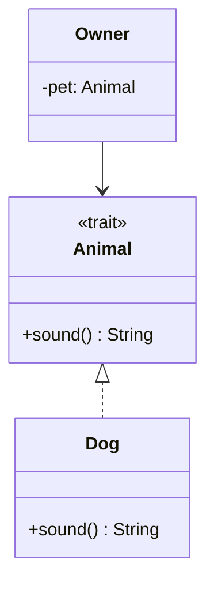
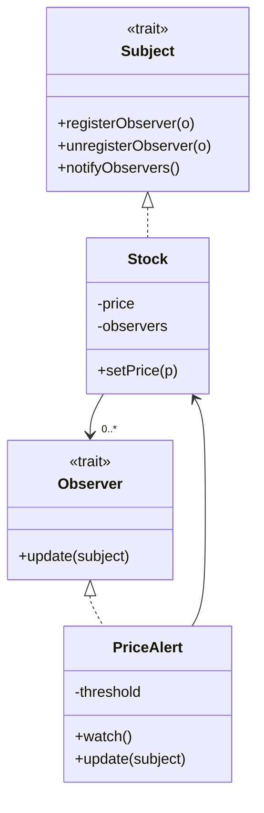
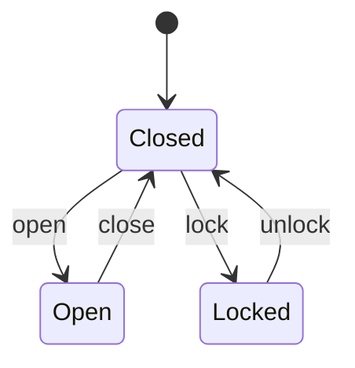
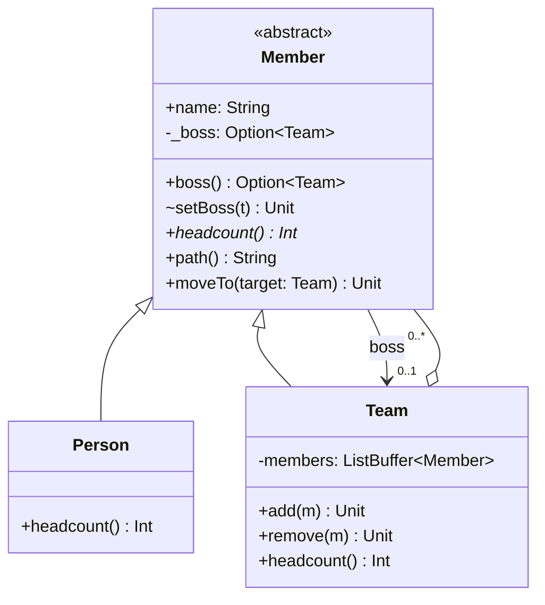
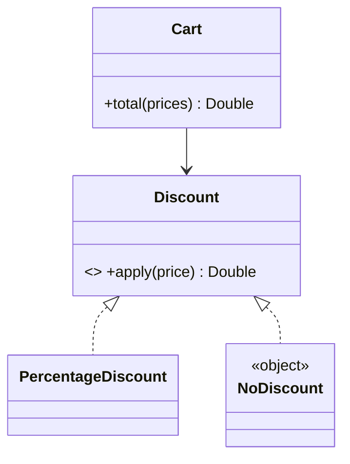
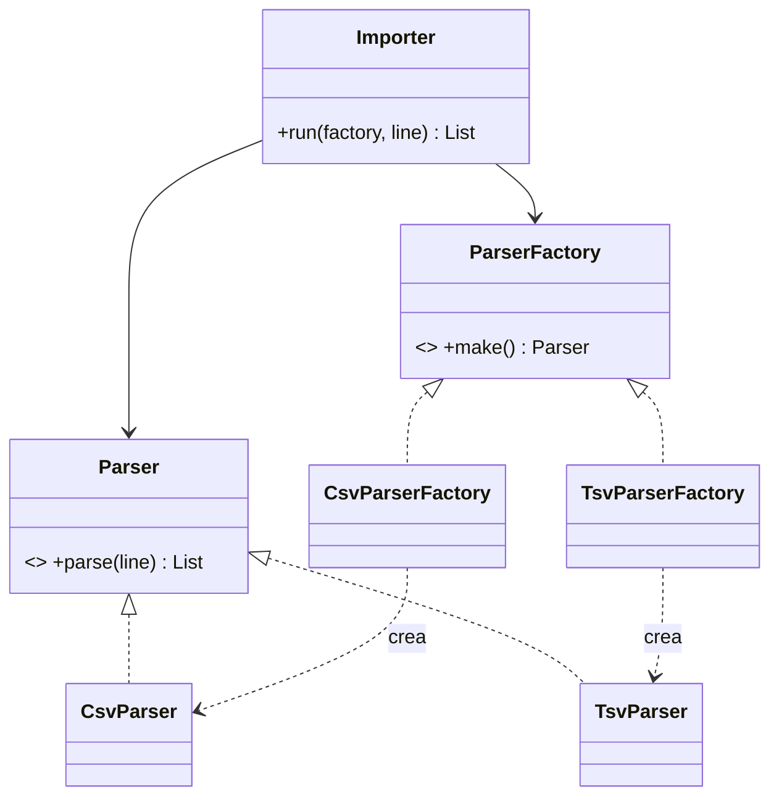
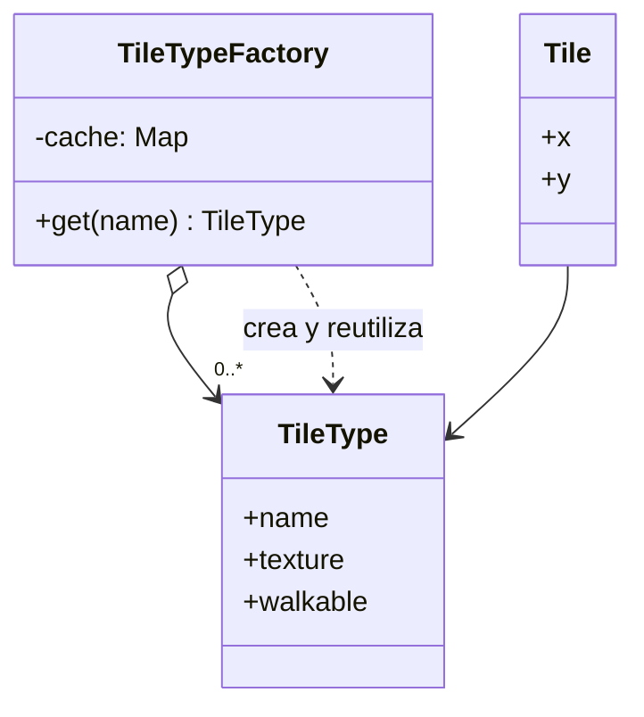

# Patrones de diseño, Expression Problem y programación funcional en Scala 3: guía de estudio

*Curso para principiantes construido a partir de las Auxiliares 10 y 11, el Repaso del Control 3 y las Clases 12, 13, 14, 15, 16 y 17 de CC3002. Primero van las lecciones; al final está la hoja de referencia rápida (cheatsheet).*

## Cómo usar esta guía

Esta guía continúa la anterior («Diseño de Software Orientado a Objetos en Scala»), que cubre encapsulamiento, Liskov, OCP, double dispatch, excepciones, genéricos y varianza. Aquí se asume que **entiendes qué es una clase, un trait y la herencia**, pero cada concepto nuevo se explica desde cero.

Cada lección tiene la misma estructura:

1. **El problema**: qué duele si no conocemos el concepto.
2. **El concepto desde cero**, con el vocabulario definido.
3. **Ejemplos guiados** en un dominio *distinto* al de los ejercicios, pero con la misma estructura, para que aprendas la idea y no memorices una solución.
4. **Errores comunes.**
5. **Cómo resolver el ejercicio**: método paso a paso, con pistas y trampas, sin entregarte la solución final.

Todo el código es Scala 3 con sintaxis de indentación. **Importante:** en el entorno donde se redactó esta guía no había compilador de Scala disponible, así que ningún ejemplo fue compilado; cada uno fue releído a mano buscando errores de sintaxis y de tipos. Si algo no compila en tu máquina, es un error mío: copia el ejemplo a Scastie, IntelliJ o Scala CLI y avísame del mensaje del compilador.

### Limitaciones del material

- **Todas las clases adjuntas fueron incluidas**, incluida la Clase 16 («OOP vs FP»), que forma las lecciones 13 y 14.
- Las diapositivas «Solución» de la **Auxiliar 11** son diagramas y código que no aparecieron al extraer el texto del PDF (solo se ven las etiquetas). Por eso construí mis propios ejemplos para cada patrón.
- La Clase 15 termina con «vamos a describir en vivo un enfoque para Scala» para resolver el Expression Problem. Ese enfoque **no está en las diapositivas**; la Lección 12 lo señala y no lo inventa.

### Mapa de dependencias

```
L0 Scala mínimo ──► L1 Qué es un patrón + UML
                       │
        ┌──────────────┼───────────────────────────┐
        ▼              ▼                           ▼
   L2 Adapter/Proxy  L3 Observer ──► L4 State   L5 Template ──► L6 Composite
                                                    │               │
                      L7 Singleton ──► L8 Null Object               │
                      L9 Factory Method                             │
                      L10 Flyweight (usa L9 y L7 como ideas)        │
                                                    ▼               ▼
                                   L11 Visitor (usa double dispatch y Composite)
                                                    ▼
                                   L12 Pattern matching y Expression Problem
                                                    ▼
                                   L13 OOP vs FP, inmutabilidad, funciones puras
                                                    ▼
                                   L14 Orden superior y colecciones (map, flatMap, fold...)
                                                    ▼
                                   L15 For comprehensions (Option, State monad)
```

### Mapa: qué lección necesitas para cada ejercicio

| Ejercicio | Fuente | Lecciones |
| --- | --- | --- |
| Endless runner de Jake (State + Observer) | Auxiliar 10 | 3, 4 |
| 6 escenarios «¿qué patrón?» (Flyweight, Composite, Singleton, Factory, Null, Template) | Auxiliar 11 | 5 a 10 |
| P1 Pagos legacy (Adapter + Proxy) | Repaso C3 | 2 |
| P2 Semáforos y vehículos (Observer) | Repaso C3 | 3 |
| P3 Guardia de videojuego (State) | Repaso C3 | 4 |
| P4 Plantación de árboles (Template Method) | Repaso C3 | 5 |
| P5 Sistema de archivos con `padre()` (Composite) | Repaso C3 | 6 |
| P6 Notificaciones opcionales (Null Object) | Repaso C3 | 8 |
| P7 Figuras y Expression Problem (Visitor) | Repaso C3 | 11, 12 |
| P8 Unidades de un RTS (Flyweight) | Repaso C3 | 10 |
| Ejercicios de clase: Fibonacci puro, `getWords`, `max` con `fold`, `map` con `foldLeft`/`foldRight`, invertir una lista | Clase 16 | 13, 14 |
| Ejercicios de clase: `scalarProduct`, traducción de `for`, `game.run(20)` | Clase 17 | 14, 15 |

---

## Lección 0: el Scala mínimo para leer este material

Solo incluyo lo que aparece en las diapositivas y ejercicios. Para excepciones, genéricos, varianza y `require`, ver la guía anterior (lecciones 0, 3, 4 y 5).

### 0.1 Clases, traits y constructores

```scala
trait Animal:                          // contrato: puede tener métodos abstractos (sin cuerpo)
  def sound(): String

abstract class Base(val name: String) extends Animal:   // no se puede instanciar con new
  override def toString: String = s"Animal($name)"

class Dog(name: String) extends Base(name):
  override def sound(): String = "guau"
```

- `val` en un parámetro del constructor crea un **campo público de solo lectura**; `private var` crea un campo privado mutable.
- **Constructor protegido:** `class GameState protected():` significa «solo las subclases pueden hacer `new`». Los paréntesis `()` son necesarios aquí: la propia Clase 12 lo anota (ver errata E8).
- `override` se escribe al redefinir un método que ya tenía cuerpo, y conviene al implementar uno abstracto.
- `final def m()` impide que una subclase lo redefina (útil en Template Method).

### 0.2 `object`, objeto compañero y `case class`

```scala
object NoDiscount extends Discount:     // object = UNA única instancia, sin new
  def apply(price: Double): Double = price

class AppConfig private (val theme: String)
object AppConfig:                        // objeto compañero: mismo nombre, mismo archivo
  def default: AppConfig = new AppConfig("light")   // puede usar el constructor privado

case class Point(x: Int, y: Int)         // sin new; ==, toString y pattern matching gratis
sealed trait Shape                       // sus subtipos solo pueden definirse en este archivo
```

`sealed` le permite al compilador saber **todos** los subtipos y avisarte si un `match` no los cubre.

### 0.3 Colecciones y funciones como valores

```scala
import scala.collection.mutable
val buf = mutable.ListBuffer.empty[Int]           // lista mutable
buf += 1                                          // agrega al final
val seen = mutable.LinkedHashSet.empty[String]    // conjunto mutable que recuerda el orden de inserción
seen += "a"; seen -= "a"                          // agregar / quitar
val cache = mutable.Map.empty[Char, String]
cache.getOrElseUpdate('a', "A")                   // si la llave existe la devuelve; si no, calcula, guarda y devuelve
val f: () => Unit = () => println("hola")         // una función sin parámetros es un valor
def twice(op: () => Unit): Unit = { op(); op() }  // función de orden superior: recibe otra función
```

`xs.toList` en una colección mutable entrega una **copia inmutable** (lo usaremos en Observer). `a eq b` compara **referencias** (¿es el mismo objeto?), mientras que `a == b` compara contenido si la clase lo define.

### 0.4 Opcionales y excepciones (repaso mínimo)

```scala
val o: Option[Int] = Some(3)           // o None
o.foreach(println)                     // ejecuta solo si hay valor
class BadMove(msg: String) extends Exception(msg)
try riskyCall() catch case e: BadMove => println(e.getMessage)
```

### 0.5 Pattern matching básico

```scala
def kind(x: Any): String = x match
  case 0         => "cero"
  case n: Int    => s"entero $n"
  case Some(v)   => s"algo: $v"
  case _         => "otra cosa"
```

Se revisan los `case` de arriba hacia abajo y se ejecuta el primero que calza. La Lección 12 lo explica a fondo.

### 0.6 Programa principal y pruebas

```scala
@main def demo(): Unit = println("hola")

class MyTest extends munit.FunSuite:                 // las diapositivas usan munit
  test("suma"):
    assertEquals(1 + 1, 2)
```

### 0.7 Otros detalles que aparecen

- **Parámetros por defecto:** `class Client(logger: Logger = NullLogger)` permite `new Client()`.
- **Modificador con paquete:** `private[org] def f()` significa «visible solo dentro del paquete `org`». Lo usaremos en Composite.
- **Tipo unión:** `Notifier | Null` aparece en el enunciado de la P6; no lo necesitaremos en la solución.
- `???` es «aún no implementado»: compila en cualquier lugar y lanza un error al ejecutarse.
- `(Int, Int)` es una **tupla**; `val (a, b) = par` la descompone.

---

## Lección 1: qué es un patrón de diseño, cómo leer UML y los principios SOLID que los justifican

### 1.1 El problema

Programadores distintos resuelven una y otra vez los mismos problemas de diseño («¿cómo aviso a muchos objetos que algo cambió?», «¿cómo evito un `if` gigante según el estado?»). Sin un vocabulario común, cada equipo reinventa la solución, a veces mal, y no puede explicarla en pocas palabras.

### 1.2 El concepto

Un **patrón de diseño** es una solución reutilizable a un problema común en un contexto dado (Clase 12). Describe *cuándo* aplicarlo, *qué problema* resuelve y *qué costo* introduce. Tres aclaraciones de la Clase 12:

- **No es código para copiar**: es una idea que se adapta al contexto.
- **No es un algoritmo ni una estructura de datos**: resuelve cómo *colaboran* los componentes, no cómo ordenar una lista.
- **No es un patrón de arquitectura** (MVC, microservicios): organiza colaboraciones *locales* entre clases u objetos.
- **No mejora un diseño automáticamente**: solo cuando responde a un problema real. Aplicarlo «porque sí» es sobreingeniería, y por eso cada lección lista sus costos.

**Tres familias** (Clase 12; Auxiliar 11):

| Familia | Qué decide | Patrones del curso |
| --- | --- | --- |
| **Creacionales** | cómo se crean los objetos | Singleton, Factory Method |
| **Estructurales** | cómo se componen clases y objetos | Adapter, Proxy, Composite, Flyweight |
| **De comportamiento** | cómo se reparten responsabilidades y se comunican | Observer, State, Template Method, Null Object, Visitor |

### 1.3 Los principios que aparecen en «lo bueno» y «lo malo»

| Principio | Idea | Dónde aparece |
| --- | --- | --- |
| **OCP** (abierto/cerrado) | extender sin modificar código existente | Adapter, Proxy, Observer, Template, Composite, Null, Factory, Visitor |
| **SRP** (responsabilidad única) | cada clase hace una cosa | Adapter, Proxy, Observer; Singleton y Null pueden comprometerlo |
| **DIP** (inversión de dependencias) | depender de abstracciones, no de clases concretas | Adapter, Factory, Null Object |

### 1.4 UML mínimo para los ejercicios

Los ejercicios P2, P3, P4, P5 y P8 piden diagramas. Notación suficiente:

| Elemento | Se dibuja | Significado |
| --- | --- | --- |
| Clase | caja con tres compartimentos: nombre, atributos, métodos | |
| Trait / interfaz | caja con `«trait»` o `«interface»` sobre el nombre | |
| Clase o método abstracto | nombre en *cursiva* o marcado `{abstract}` | |
| Visibilidad | `+` público, `-` privado, `#` protegido | `- state: GameState` |
| Herencia (`extends` de clase) | flecha con triángulo **vacío**, línea continua | hijo → padre |
| Implementación de trait | flecha con triángulo vacío, línea **punteada** | |
| Asociación / «tiene un» | línea con flecha simple (a veces con multiplicidad `0..*`) | `Context → State` |

Un ejemplo con Mermaid (se renderiza en muchos visores de Markdown):



**Consejo para el control:** dibuja primero los traits/clases abstractas, luego las concretas, luego las flechas. Marca *explícitamente* qué métodos son abstractos y qué atributos son privados.

### 1.5 Errores comunes

- Memorizar el UML de cada patrón sin entender qué problema resuelve: en el control te darán un enunciado en otro dominio.
- Elegir un patrón por su nombre y no por el problema. El método fiable: ¿qué **duele** en el enunciado? (ver el procedimiento de decisión en R1).
- Confundir patrones estructurales parecidos (Adapter vs Proxy; Composite vs Flyweight).

### 1.6 Cómo resolver los ejercicios «¿qué patrón?»

Para cada enunciado (Auxiliar 11, ejercicios 1 a 6; P1a, P4a, P6a, P7b, P8a del Repaso C3):

1. **Subraya el dolor**, no el dominio: «millones de objetos con datos repetidos», «jerarquía donde hojas y grupos se tratan igual», «una sola instancia compartida», «comprobar null por todos lados», «mismo algoritmo, pasos distintos», «new acoplado a clases concretas».
2. Busca en la tabla de decisión R1 el patrón cuyo *problema* calza.
3. **Justifica con una frase del enunciado** («el enunciado dice X, por eso Y»).
4. Si dudas entre dos, revisa la comparación (Adapter vs Proxy en la Lección 2).

---

## Lección 2: Adapter y Proxy

*Fuente: Clase 12 (secciones Adapter y Proxy; Freeman y Robson, caps. «Adapter and Facade» y «Proxy»; Gamma et al., «Adapter» y «Proxy»). Ejercicio: Repaso C3, P1.*

### 2.1 El problema

**Adapter.** Tienes una clase que hace lo que necesitas, pero su interfaz no coincide con la que tu código espera, y no puedes modificarla (por ejemplo, es de una librería externa o de un sistema legacy).

**Proxy.** Quieres ejecutar lógica *antes o después* de una operación (verificar permisos, registrar actividad, medir rendimiento, retrasar la creación de un objeto costoso), pero no quieres ni puedes tocar la clase original.

### 2.2 Los conceptos

**Adapter** (patrón estructural): un objeto **envuelve** al objeto original y **traduce** la interfaz esperada por el cliente a la interfaz real. Es un puente entre interfaces incompatibles.

- *Target*: la interfaz que espera el cliente.
- *Adaptee*: la clase existente con interfaz distinta.
- *Adapter*: implementa el *Target* y delega en el *Adaptee*.

**Proxy** (patrón estructural): un objeto intermediario que implementa **la misma interfaz** que el objeto real, ejecuta acciones previas y/o posteriores y delega. El cliente no nota la diferencia.

| Patrón | ¿Mantiene la misma interfaz? | Intención principal |
| --- | --- | --- |
| Adapter | No necesariamente | Hacer compatible una interfaz |
| Proxy | Sí | Controlar acceso, creación, logging, caché, permisos |

Una regla mnemotécnica: el **Adapter cambia la forma** de hablar con un objeto; el **Proxy cambia lo que ocurre** al hablar con él, pero habla igual.

### 2.3 Ejemplo guiado: termómetros (dominio distinto al ejercicio)

Tu aplicación trabaja con grados Celsius a través de un `Sensor`:

```scala
trait Sensor:
  def celsius(): Double

class Dashboard(sensor: Sensor):
  def show(): String = s"Temperatura: ${sensor.celsius()} °C"
```

Una librería externa ofrece otra cosa, que no podemos tocar:

```scala
class LegacyThermometer:
  def readFahrenheit(): Double = 98.6
```

**Paso 1, el adaptador.** Implementa `Sensor` y traduce. Fíjate que recibe el *adaptee* por el constructor, en vez de crearlo adentro (así podemos pasarle cualquier instancia, incluso una falsa en los tests):

```scala
class ThermometerAdapter(legacy: LegacyThermometer) extends Sensor:
  override def celsius(): Double = (legacy.readFahrenheit() - 32) * 5 / 9

val dashboard = new Dashboard(new ThermometerAdapter(new LegacyThermometer))
println(dashboard.show())     // Temperatura: 37.0 °C (aprox., por redondeo de Double)
```

`Dashboard` nunca se entera de que existe `LegacyThermometer`: depende de la abstracción `Sensor` (DIP).

**Paso 2, un proxy de registro.** Misma interfaz `Sensor`; agrega lógica antes y después:

```scala
class LoggingSensor(real: Sensor) extends Sensor:
  override def celsius(): Double =
    println("[PRE] leyendo sensor")
    val value = real.celsius()
    println(s"[POST] valor = $value")
    value
```

**Paso 3, un proxy de control de acceso.** Decide si delega o no:

```scala
class RestrictedSensor(real: Sensor, user: String, allowed: Set[String]) extends Sensor:
  override def celsius(): Double =
    if allowed.contains(user) then real.celsius()
    else throw new SecurityException(s"$user no tiene permiso")
```

**Paso 4, componer.** Como todos implementan `Sensor`, se pueden apilar como capas:

```scala
val sensor: Sensor =
  new LoggingSensor(
    new RestrictedSensor(
      new ThermometerAdapter(new LegacyThermometer),
      "ana",
      Set("ana")))
new Dashboard(sensor).show()
```

**Traza** de `sensor.celsius()`: entra `LoggingSensor` (imprime `[PRE]`) → llama a `RestrictedSensor`, que verifica a `"ana"` → llama a `ThermometerAdapter`, que llama a `readFahrenheit()` y convierte → los valores suben de vuelta y `LoggingSensor` imprime `[POST]`.

**El orden de las capas importa.** Con el `LoggingSensor` por fuera, se registran también los intentos *rechazados* (el `[PRE]` se imprime antes de que se lance la excepción; el `[POST]` no). Con el `RestrictedSensor` por fuera, los intentos rechazados no se registran.

### 2.4 Errores comunes

- Crear el objeto real dentro del proxy o adaptador con `new` (las diapositivas lo hacen por simplicidad). En un diseño real, recíbelo por el constructor: es más testeable y evita acoplarte a la clase concreta.
- Agregar lógica de negocio al adaptador: debe **solo traducir** (SRP).
- Hacer un proxy que **no implementa** la interfaz del objeto real: entonces es un adaptador y el cliente tendría que cambiar.
- Poner el proxy en el nivel equivocado: si la lógica del proxy necesita un dato que la interfaz interna ya perdió, no podrá implementarse (ver P1 abajo).
- Abusar: demasiadas capas dificultan seguir y depurar el código (el «lo malo» de la Clase 12).

### 2.5 Cómo resolver el ejercicio (Repaso C3, P1)

1. **Lee las dos necesidades por separado.** (i) «Una interfaz `PaymentProcessor` que reciba un `Payment` en vez de un monto» y (ii) «agregar autenticación y registro antes de delegar, sin modificar `SimplePaymentSystem`». Pregúntate para cada una: ¿cambia la *forma* de la interfaz o cambia lo que ocurre *alrededor* de una llamada con la misma forma? Eso decide el patrón de la parte (a). Redacta la frase de diferencia conceptual con ayuda de la tabla de 2.2.
2. **Parte (b): el adaptador.** Identifica el *Target* (`PaymentProcessor`, que deberás declarar), el *Adaptee* (`PaymentSystem`/`SimplePaymentSystem`) y qué dato del `Payment` necesita el adaptee. Recibe el sistema legacy por el constructor.
3. **Parte (c): el proxy.** Pregunta clave: ¿sobre qué interfaz lo defino, `PaymentSystem` o `PaymentProcessor`? Piensa qué datos necesita la **autenticación** (¿quién paga?) y cuáles de ellos llegan a cada interfaz. Después decide qué registra el log (antes, después, o ambos) y qué ocurre si el usuario no está autorizado.
4. **Define qué significa «autenticación»**: el enunciado no lo especifica. Documenta tu supuesto (por ejemplo, un conjunto de remitentes autorizados) y no inventes infraestructura extra.
5. **Ejemplo de uso:** arma la cadena (proxy → adaptador → legacy) y muestra un pago autorizado y otro rechazado. Si un pago rechazado debe llegar al legacy, algo está mal.
6. **Prueba primero (TDD):** un test que verifique que el legacy *no* fue llamado cuando el pago se rechaza (por ejemplo con un legacy falso que registra sus llamadas).

---

## Lección 3: Observer

*Fuente: Clase 12 (sección Observer; Freeman y Robson, «The Observer Pattern»; Gamma et al., «Observer»); Auxiliar 10 (parte Observer). Ejercicios: Auxiliar 10 (R6), Repaso C3, P2.*

### 3.1 El problema

Varios objetos necesitan reaccionar cuando cambia el estado de otro. Si el objeto que cambia (el **sujeto**) conoce explícitamente a todos sus dependientes y les llama métodos fijos:

- aumenta el **acoplamiento** (el sujeto depende de cada clase concreta);
- agregar un nuevo dependiente obliga a **modificar el sujeto** (rompe OCP).

Una alternativa torpe es que el dependiente **pregunte** periódicamente («¿ya cambió?»): obliga a acordarse de preguntar tras *cada* acción y desperdicia trabajo.

### 3.2 El concepto

**Observer** (patrón de comportamiento) define una relación **uno-a-muchos**: cuando un objeto cambia, **notifica automáticamente** a todos sus observadores. Los observadores pueden suscribirse y desuscribirse dinámicamente.

| Participante | Rol | Nombres alternativos |
| --- | --- | --- |
| **Subject** | guarda la lista de observadores y los notifica | Observable, Publisher |
| **Observer** | define la interfaz `update` que recibe la notificación | Listener, Subscriber |

La clave: el sujeto guarda una lista de `Observer` (el trait), **nunca** de clases concretas. Así el modelo no depende de quienes lo observan. El *observador concreto* sí conoce al sujeto (para suscribirse).

**Dos estilos de interfaz que verás:**

```scala
// Auxiliar 10 / Repaso C3: el observador recibe el sujeto y consulta lo que necesite ("pull")
trait Observer:
  def update(subject: Subject): Unit
trait Subject:
  def registerObserver(o: Observer): Unit
  def unregisterObserver(o: Observer): Unit
  def notifyObservers(): Unit

// Clase 12: la notificación lleva datos ("push") y es genérica para evitar downcasting
trait Observer[T]:
  def update(subject: Subject[T], response: T): Unit
trait Subject[T]:
  def attach(observer: Observer[T]): Unit
  def detach(observer: Observer[T]): Unit
  def notifyObservers(notification: T): Unit
```

Los nombres (`registerObserver`/`attach`) cambian entre fuentes; la idea es la misma. **Usa los nombres que dé el enunciado.** La versión genérica de la Clase 12 existe porque con `response: Any` hay que hacer `isInstanceOf`/`asInstanceOf`, y el compilador deja de garantizar los tipos.

### 3.3 Ejemplo guiado: alertas de precio de una acción

Dominio distinto, misma estructura que «semáforo y vehículos»: un sujeto cuyo cambio provoca que ciertos observadores **actúen una vez y se desuscriban**.

```scala
import scala.collection.mutable

trait Observer:
  def update(subject: Subject): Unit
trait Subject:
  def registerObserver(o: Observer): Unit
  def unregisterObserver(o: Observer): Unit
  def notifyObservers(): Unit

class Stock(val symbol: String) extends Subject:
  private var _price: Double = 0.0
  private val observers = mutable.LinkedHashSet.empty[Observer]

  def price: Double = _price
  def setPrice(newPrice: Double): Unit =
    _price = newPrice
    notifyObservers()

  override def registerObserver(o: Observer): Unit = observers += o
  override def unregisterObserver(o: Observer): Unit = observers -= o
  override def notifyObservers(): Unit =
    for o <- observers.toList do o.update(this)     // iteramos sobre una COPIA (ver 3.4)
```

El observador de este ejemplo se suscribe a sí mismo y, cuando se cumple su condición, actúa y se desuscribe del sujeto que le avisó:

```scala
class PriceAlert(stock: Stock, threshold: Double) extends Observer:
  var fired: Boolean = false
  def watch(): Unit = stock.registerObserver(this)          // análogo a "onRedLight"
  override def update(subject: Subject): Unit =
    if stock.price >= threshold then
      println(s"${stock.symbol} llegó a ${stock.price}")
      fired = true
      subject.unregisterObserver(this)                      // análogo a "avanzar y desuscribirse"
```

Uso:

```scala
@main def alertsDemo(): Unit =
  val acme = new Stock("ACME")
  val a1 = new PriceAlert(acme, 100)
  val a2 = new PriceAlert(acme, 150)
  a1.watch(); a2.watch()
  acme.setPrice(120)     // imprime "ACME llegó a 120.0"; a1 se desuscribe
  acme.setPrice(160)     // imprime "ACME llegó a 160.0"; a2 se desuscribe
  acme.setPrice(200)     // nadie escucha: no imprime nada
```

**Traza de `acme.setPrice(120)`:** se guarda el precio → `notifyObservers()` copia la lista `[a1, a2]` → `a1.update(acme)`: `120 >= 100`, imprime, se desuscribe → `a2.update(acme)`: `120 >= 150` es falso, no hace nada, sigue suscrito. Observa que `Stock` jamás menciona `PriceAlert`: se podría agregar un `EmailAlert` sin tocar `Stock`.



### 3.4 El error más sutil: modificar la colección mientras se recorre

Si `notifyObservers` recorre directamente `observers` y un observador se desuscribe **dentro de `update`**, se está modificando la colección durante el recorrido. El resultado es impredecible (puede saltarse a un observador o fallar). Por eso el ejemplo itera sobre `observers.toList`, una copia. Este caso es *exactamente* el del ejercicio P2: el vehículo se desuscribe dentro de su propio `update`.

### 3.5 Observer + State (Auxiliar 10)

La Auxiliar 10 usa los dos patrones juntos. La regla R6 («si se acaba la stamina, Jake es atrapado») es un Observer: el **modelo** (`Jake`) es el sujeto y el **controlador** (`GameController`, que maneja el estado) es el observador. Observa la dirección de las dependencias:

- `Jake` guarda una lista de `Observer`, **no** de `GameController`: el modelo nunca depende del controlador.
- `GameController` conoce a `Jake` y se registra en él al crearse.
- Alternativa descartada: que el controlador pregunte la stamina tras cada acción. Problemas: hay que acordarse de preguntar en *cada* camino, el controlador queda acoplado a los detalles del modelo, y se hace trabajo aunque nada haya cambiado.

Flujo: `Jake.loseStamina()` → `notifyObserver()` → `GameController.update()` → el estado pasa a `Caught`.

### 3.6 Lo bueno y lo malo (Clase 12)

**Bueno:** desacopla emisores y receptores; permite agregar y quitar observadores en ejecución; cumple OCP y SRP; potencial de paralelización.
**Malo:** complejidad adicional; con muchos observadores las actualizaciones pueden ser lentas; puede haber problemas de orden o de dependencia entre observadores; es difícil rastrear errores si un observador modifica al sujeto dentro de `update`.

### 3.7 Errores comunes

- Que el sujeto guarde la lista de **clases concretas** en vez del trait `Observer`.
- Iterar sobre la colección original mientras los observadores se desuscriben (3.4).
- Olvidar suscribir al observador (el sujeto notifica y nadie reacciona).
- Hacer downcasting del parámetro de `update` con `isInstanceOf`: si necesitas datos del sujeto, guarda una referencia al sujeto concreto (como `PriceAlert`) o usa la versión genérica.
- Notificar **antes** de actualizar el estado: los observadores verían el valor viejo.
- Desuscribirse del sujeto equivocado: el sujeto que te avisó llega como argumento de `update`.

### 3.8 Cómo resolver los ejercicios

**Repaso C3, P2 (semáforos y vehículos):**

1. **Identifica roles:** ¿quién cambia? (sujeto). ¿Quién reacciona? (observador). Esto fija qué clase implementa qué trait. Ya tienes las interfaces: no las modifiques.
2. **Parte (a), diagrama de clases:** dibuja los dos traits, las dos clases concretas, la relación «implementa» (punteada) y la asociación «el sujeto guarda `0..*` observadores». Pregunta: ¿qué flecha tiene que existir entre `Vehicle` y `TrafficLight` para que `onRedLight` pueda suscribirse?
3. **Parte (b), qué debe hacer cada método.** Escribe en una línea por método: `onRedLight` (¿qué recibe? ¿se detiene *y* se suscribe, en qué orden?), `update` (¿avanza *y* se desuscribe de cuál sujeto?) y el método del semáforo que cambia a verde (¿qué hace antes de notificar?).
4. **No implementes los métodos de `Subject`** (lo dice el enunciado), pero para probar tu código en un test sí necesitas una colección real; usa el `BaseSubject` de la Clase 12 o el esqueleto de 3.3. Cuida el punto 3.4.
5. **Prueba primero:** un vehículo se detiene en rojo y *no* avanza; el semáforo pasa a verde y el vehículo avanza; un segundo cambio a verde **no** lo vuelve a avanzar (ya se desuscribió).
6. **Parte (c):** compara qué obligaría a modificar el código si mañana se suman peatones o ambulancias en cada diseño (referencias directas vs. interfaz `Observer`). Conecta tu respuesta con OCP y con acoplamiento.

**Auxiliar 10, parte Observer:**

1. Define `Subject` y `Observer` (paso 1 de la auxiliar).
2. Haz que `Jake` implemente `Subject` con una lista de observadores, y que `loseStamina` notifique cuando la stamina no alcanza (paso 2).
3. Haz que `GameController` implemente `Observer` y se registre en `Jake` al crearse (paso 3). Decide qué hace su `update` (pasar al estado `Caught`).
4. Atención a la errata E3: la auxiliar usa `stamina - loss < 0`, pero el diagrama dice «stamina = 0». Decide cuál criterio usas y documéntalo en el test.

---

## Lección 4: State

*Fuente: Clase 12 (sección State, pasos 1 a 6; Freeman y Robson, «The State Pattern»; Gamma et al., «State»); Auxiliar 10 (parte State). Ejercicios: Auxiliar 10 (R1 a R5), Repaso C3, P3.*

### 4.1 El problema

Un objeto se comporta distinto según su estado interno. La solución ingenua usa condicionales (`if state == "A" ... else if state == "B" ...`) en **cada** método. Consecuencias (Clase 12):

- el comportamiento de cada estado queda **disperso** entre muchos métodos (baja cohesión);
- agregar un estado obliga a **modificar todos los métodos** (rompe OCP);
- es difícil de mantener y de probar.

Un vistazo al olor, con una puerta que puede estar cerrada, abierta o con llave:

```scala
class BadDoor:
  private var state = "CLOSED"
  def open(): Unit =
    if state == "CLOSED" then state = "OPEN"
    else if state == "OPEN" then ()                                    // ¿ignorar? ¿error?
    else throw new IllegalStateException("la puerta está con llave")
  // ...y lo mismo, con otra cadena de if, en close(), lock() y unlock()
```

Un estado nuevo (`"BROKEN"`) obliga a editar los cuatro métodos, y un error de tipeo en un string solo se descubre al ejecutar.

### 4.2 El concepto

**State** (patrón de comportamiento): extrae el comportamiento de cada estado a **clases separadas**. El objeto principal (el **contexto**) mantiene una referencia a su estado actual y **delega** en él. Los cambios de estado se hacen reemplazando esa referencia, de forma polimórfica y sin condicionales.

| Participante | Rol |
| --- | --- |
| **Contexto** | guarda el estado actual y delega cada operación en él |
| **Estado base** | contrato común; por defecto, cada operación es una **transición inválida** |
| **Estados concretos** | una clase por nodo del diagrama de estados; **sobrescriben solo las flechas que salen de él** |

La idea de oro (Auxiliar 10): **una clase por estado, un método sobrescrito por flecha de salida**.

### 4.3 Receta en seis pasos (Clase 12) aplicada a una puerta

Este es el ejemplo guiado (dominio distinto: puerta con llave).

**Paso 1: identificar los estados.** `Closed`, `Open`, `Locked`.

**Paso 2: identificar las transiciones válidas** (y dibujarlas).



Todo lo que no es una flecha es una **transición inválida** (por ejemplo `lock` estando `Open`).

**Paso 3: excepción para transiciones inválidas.**

```scala
class InvalidTransitionException(action: String, state: String)
  extends Exception(s"Invalid transition: cannot '$action' when in state '$state'")
```

**Paso 4: estado base.** Todas las acciones fallan por defecto; los estados concretos sobrescriben solo las válidas. Los predicados `isX` existen **solo para tests**, no para controlar el flujo (si los usaras en `if`, volverías a los condicionales):

```scala
class DoorState protected ():
  def open(door: Door): Unit   = error("open")
  def close(door: Door): Unit  = error("close")
  def lock(door: Door): Unit   = error("lock")
  def unlock(door: Door): Unit = error("unlock")

  private def error(action: String): Nothing =
    throw new InvalidTransitionException(action, getClass.getSimpleName)

  // ¡SOLO PARA TESTEAR!
  def isClosed: Boolean = false
  def isOpen: Boolean   = false
  def isLocked: Boolean = false
```

`Nothing` es el tipo de una expresión que nunca devuelve valor (siempre lanza): por eso `error(...)` cabe en un método que debería devolver `Unit`.

**Paso 5: estados concretos.** Solo las flechas de salida:

```scala
class Closed extends DoorState:
  override def open(door: Door): Unit = door.setState(new Open)
  override def lock(door: Door): Unit = door.setState(new Locked)
  override def isClosed: Boolean = true

class Open extends DoorState:
  override def close(door: Door): Unit = door.setState(new Closed)
  override def isOpen: Boolean = true

class Locked extends DoorState:
  override def unlock(door: Door): Unit = door.setState(new Closed)
  override def isLocked: Boolean = true
```

**Paso 6: el contexto.** Guarda el estado y delega, sin preguntar en cuál está:

```scala
class Door:
  private var _state: DoorState = new Closed
  def state: DoorState = _state                    // lectura, útil para tests
  def setState(s: DoorState): Unit = _state = s
  def open(): Unit   = _state.open(this)
  def close(): Unit  = _state.close(this)
  def lock(): Unit   = _state.lock(this)
  def unlock(): Unit = _state.unlock(this)
```

**Traza** de `door.lock(); door.open()` partiendo de `Closed`: `lock()` → `Closed.lock(door)` → `door.setState(new Locked)`. Luego `open()` → `Locked.open(door)`. `Locked` no sobrescribió `open`, así que corre el método heredado de `DoorState`, que llama a `error("open")` y lanza `InvalidTransitionException: cannot 'open' when in state 'Locked'`.

**Tests** (munit):

```scala
class DoorTest extends munit.FunSuite:
  test("una puerta cerrada se puede bloquear"):
    val door = new Door
    door.lock()
    assert(door.state.isLocked)

  test("una puerta bloqueada no se puede abrir"):
    val door = new Door
    door.lock()
    intercept[InvalidTransitionException](door.open())
```

**Variante de la Clase 12:** el contexto captura la excepción y la imprime, y para no duplicar el `try` en cada método usa una función de orden superior:

```scala
  private def safeRun(op: () => Unit): Unit =
    try op()
    catch case e: InvalidTransitionException => println(e.getMessage)
  def open(): Unit = safeRun(() => _state.open(this))
```

**Qué elegir:** lanzar la excepción (Auxiliar 10: «el programa debe rechazarla con una excepción, no ignorarla en silencio») permite probar con `intercept`; capturarla en el contexto sirve cuando el usuario final no debe ver un fallo. Declara cuál usas.

### 4.4 La variante de la Auxiliar 10

La auxiliar separa dos tipos de métodos:

- **`toXState()`: la transición** (cambia el estado).
- **`doX()`: la acción** (lo que el usuario pide), que puede tener **efectos extra** además de la transición.

Por ejemplo, `Running.doJump()` hace `toJumpingState()` y *además* consume stamina. Así, la acción compone una transición y un efecto. Otros detalles de su diseño:

- hay una **interfaz** (`States`) con todas las transiciones y acciones, y una **clase abstracta** (`GameState`) donde todo lanza una excepción por defecto;
- dos excepciones distintas, una para transiciones inválidas y otra para acciones inválidas, para que el mensaje diga qué falló;
- el constructor de `GameState` ejecuta `context.setState(this)`: crear un estado lo instala en el contexto. Es cómodo pero es un **efecto secundario oculto** (la propia auxiliar lo deja como pregunta); en la receta de la Clase 12 el cambio es explícito (`door.setState(new Open)`).

### 4.5 Lo bueno y lo malo

**Bueno:** elimina condicionales; agregar un estado no modifica los existentes; bajo acoplamiento (el contexto no conoce los detalles de cada estado).
**Malo:** más clases (una por estado); puede ser sobreingeniería si los comportamientos son simples.

### 4.6 Errores comunes

- Dejar los `if` en el contexto («por si acaso»): el patrón consiste en que el contexto **no pregunte** en qué estado está.
- Olvidar sobrescribir una flecha válida: el estado lanzará «transición inválida» para una acción que sí debería funcionar. Un test por flecha lo detecta.
- Usar `isX` dentro de la lógica del programa en vez de solo en tests.
- No definir qué ocurre con eventos que el diagrama no contempla en un estado: elige (excepción o ignorar) y documenta tu elección.
- Crear los estados con `new` dentro de cada transición sin necesidad: funciona, pero asigna objetos nuevos cada vez (como los estados no tienen datos propios, podrían ser `object`, aunque no es lo que muestran las diapositivas).
- Hacer público `setState` sin cuidado: cualquiera puede saltarse el diagrama (se ve en las diapositivas; es una simplificación).

### 4.7 Cómo resolver los ejercicios

**Auxiliar 10, parte State (endless runner de Jake):**

1. **Contexto:** `GameController` (el objeto cuyo comportamiento cambia).
2. **Estados:** busca sustantivos y gerundios en los requisitos: graffiting, running, sliding, jumping, attacking, caught. Decide cuál es el **inicial** y cuál es **final** (del que no se sale).
3. **Transiciones:** dibuja el diagrama y luego la tabla *desde ↓ / hacia →*; cada celda vacía es una transición inválida. Contrástala con tu diagrama antes de programar. Resuelve las preguntas de la auxiliar sobre qué transiciones son válidas (las respuestas están en la hoja de referencia, para revisar después).
4. **Interfaz y clase abstracta** con una excepción por defecto, y **una clase por estado** que sobrescribe solo sus flechas de salida.
5. **Acciones con efectos:** `doJump`, `doSlide` y `doAttack` consumen stamina; decide dónde vive ese costo (pista de la auxiliar: «cada estado define cuánto cuesta»).
6. **Pruebas:** una por flecha válida, y una por cada transición inválida con `intercept`. Para `Caught`, una prueba que verifique que rechaza *todas* las acciones.

**Repaso C3, P3 (guardia):**

1. **Parte (a), diagrama de estados.** Estados: Patrullando, Investigando, Atacando. Marca el estado inicial. Convierte cada oración del enunciado en una flecha **rotulada con el evento**. Cuidado con la oración «desde Patrullando *o* Investigando, si ocurre `verUnEnemigo`»: son **dos** flechas.
2. **Parte (b), diagrama de clases.** Contexto (`Guardia`) con un atributo privado `estado` y un método por evento. Una clase base de estado (trait o clase abstracta) con **un método por evento**, cada uno lanzando excepción por defecto. Tres estados concretos, cada uno con **solo** los métodos que corresponden a sus flechas de salida. Escribe en cada caja esos métodos.
3. **Define qué pasa con los eventos no listados** (por ejemplo, `escucharUnRuido` estando en Atacando): el enunciado no lo dice. Usa el comportamiento por defecto del curso (excepción) o decide ignorarlos, pero escríbelo como supuesto.
4. **Parte (c), implementación.** `Investigando` sobrescribe exactamente dos eventos: pregúntate cuáles según tu diagrama. `Guardia` inicia en `Patrullando` y delega. Reutiliza el esqueleto de 4.3.
5. **Pruebas:** recorre cada flecha del diagrama; recorre también un camino largo (`Patrullando → Investigando → Atacando → Investigando → Patrullando`).

---

## Lección 5: Template Method

*Fuente: Clase 13 (sección Template Method; Freeman y Robson, «The Template Method Pattern»; Gamma et al., «Template Method»); Auxiliar 11 (ejercicio de procesamiento de archivos y escenario 6). Ejercicio: Repaso C3, P4.*

### 5.1 El problema

Varios algoritmos tienen la **misma estructura general** (los mismos pasos en el mismo orden) pero difieren en el detalle de algunos pasos. Copiar el algoritmo completo en cada clase duplica código; forzar una sola implementación quita flexibilidad. Ejemplo de la Clase 13: procesar archivos CSV, JSON y XML sigue siempre «abrir → leer → procesar → cerrar», pero cambia cómo se lee y se interpreta.

### 5.2 El concepto

**Template Method** (patrón de comportamiento): una **clase base** define el esqueleto del algoritmo en un **método plantilla** que llama a pasos. Las subclases redefinen ciertos pasos por sobreescritura.

Vocabulario:

- **Método plantilla** (*template method*): fija el orden de los pasos. En Scala conviene marcarlo `final` para que nadie lo altere.
- **Paso concreto común:** implementado en la base, igual para todos.
- **Paso abstracto:** sin cuerpo; **toda** subclase concreta debe implementarlo.
- **Gancho** (*hook*): paso con implementación por defecto (a menudo vacía) que las subclases *pueden* redefinir.

Hay **inversión de control**: el flujo vive en la superclase y las subclases «rellenan» pasos. Por eso la Clase 13 dice: «¡Template es ideal cuando queremos *limitar* la flexibilidad!».

### 5.3 Ejemplo guiado: preparar bebidas calientes

Todas siguen: hervir agua → preparar → servir → (opcional) agregar algo. Devolvemos la lista de pasos como `List[String]` para poder testear el orden:

```scala
abstract class Beverage:
  // método plantilla: orden fijo, nadie lo puede redefinir
  final def prepare(): List[String] =
    List(boilWater(), brew(), pourInCup(), addCondiments()).filter(_.nonEmpty)

  // pasos concretos comunes
  private def boilWater(): String = "hervir agua"
  private def pourInCup(): String = "servir en taza"

  // paso abstracto: cada bebida DEBE definirlo
  protected def brew(): String

  // gancho: por defecto no hace nada, puede redefinirse
  protected def addCondiments(): String = ""

class Tea extends Beverage:
  override protected def brew(): String = "dejar reposar la bolsita"
  override protected def addCondiments(): String = "agregar limón"

class Coffee extends Beverage:
  override protected def brew(): String = "filtrar el café"     // usa el gancho por defecto
```

```scala
new Tea().prepare()
// List(hervir agua, dejar reposar la bolsita, servir en taza, agregar limón)
new Coffee().prepare()
// List(hervir agua, filtrar el café, servir en taza)
```

Observa qué es cada cosa: `prepare` es la plantilla; `boilWater` y `pourInCup` son pasos comunes y `private`; `brew` es abstracto (si `Coffee` no lo definiera, la clase `Coffee` no compilaría como clase concreta); `addCondiments` es un gancho. Agregar `HotChocolate` es una clase nueva y no se toca `Beverage` (OCP).

**La misma idea en el mini-framework de tests** de la Clase 13: `AbstractTestSuite.run()` es la plantilla (`beforeEach` → test → `afterEach` → registrar fallos); las suites concretas redefinen `beforeEach` y `afterEach`. Allí los pasos abstractos son `protected`: pertenecen a la jerarquía, no al público.

### 5.4 Lo bueno y lo malo

**Bueno:** reutiliza la estructura común; reduce duplicación; flujo estable; cumple OCP.
**Malo:** acoplamiento jerárquico fuerte (cambiar la base puede romper las subclases); difícil alterar el orden sin romper la plantilla; abusar produce árboles de herencia profundos.

### 5.5 Errores comunes

- Dejar el método plantilla sin `final` y que una subclase lo reescriba, rompiendo el orden.
- Hacer los pasos **públicos**: el cliente podría llamarlos en desorden. Usa `protected`/`private`.
- Poner en la base un paso que **no** es común a todas las variantes (la base termina con `if` según el tipo).
- Olvidar la diferencia entre paso abstracto (obligatorio) y gancho (opcional).
- Confundirlo con Factory Method: Template fija el **orden de un algoritmo**; Factory aísla **cómo se crea** un objeto.

### 5.6 Cómo resolver el ejercicio (Repaso C3, P4: plantación de árboles)

1. **Parte (a):** lee cómo se describe `plantar()`: tres pasos, en un orden fijo; dos «dependen de la distribución» y uno «es común». Ese es literalmente el problema de 5.1. La Auxiliar 11 tiene un escenario casi idéntico (informes). Justifica con esa observación.
2. **Parte (b), UML:** clase abstracta `RandomTreePlanter` que recibe las coordenadas de las dos esquinas; un método `plantar()` (plantilla); un paso concreto de dibujo; dos pasos abstractos (muestreo y filtrado); y **tres** subclases concretas. Marca en la caja qué métodos son abstractos. Revisa la errata E14: «Normal» y «Gaussiana» nombran la misma distribución; el diseño no cambia, pero no inventes una diferencia.
3. **Decide las firmas antes de programar.** ¿Cómo representas un punto (una tupla `(Double, Double)` o una `case class`)? ¿El muestreo devuelve una secuencia de puntos? ¿El filtrado recibe esa secuencia y devuelve la filtrada? ¿El dibujo recibe la filtrada? La plantilla es solo encadenar los tres.
4. **Pregúntate por qué existe el filtrado:** ¿qué distribución podría generar puntos fuera del rectángulo del terreno? Esa pista ayuda a decidir qué hace cada subclase en ese paso (y a justificar por qué es un paso variable).
5. **Parte (c):** `plantar` debería ser corto y no mencionar ninguna distribución concreta. Considera `final`.
6. **Parte (d), ejemplo de uso:** crea al menos dos plantadores distintos y llama a `plantar()`. Para poder probar, haz que el paso de dibujo imprima o acumule los puntos (por ejemplo, en un test con semilla fija de `scala.util.Random`).

---

## Lección 6: Composite

*Fuente: Clase 13 (sección Composite; Martin, «Composite»; Gamma et al., «Composite»; Shvets, Refactoring.Guru); Auxiliar 11 (ejercicio de tienda y escenario 2). Ejercicio: Repaso C3, P5.*

### 6.1 El problema

Muchos sistemas trabajan con **jerarquías** (archivos y carpetas, menús, componentes de UI, escenas gráficas). Si tratas por separado a los elementos simples y a los grupos, cada operación necesita `if` para distinguirlos y el código se duplica. Queremos tratar un elemento individual y un grupo **de la misma manera**, como nodos de un mismo árbol.

### 6.2 El concepto

**Composite** (patrón estructural): objetos simples y compuestos implementan la **misma interfaz**; los compuestos **delegan** sus operaciones en sus hijos.

| Participante | Rol |
| --- | --- |
| **Componente** | interfaz común (trait o clase abstracta) |
| **Hoja** (*leaf*) | nodo terminal; hace la operación directamente |
| **Compuesto** (*composite*) | guarda una colección de componentes; implementa la operación recorriéndola y delegando |

El cliente solo habla con el *Componente*; no sabe (ni le importa) si tiene delante una hoja o un grupo. La recursión recorre árboles de cualquier profundidad con poco código.

### 6.3 La variante «con padre»

El ejercicio P5 pide que cada elemento conozca a su contenedor: `padre(): Option[Carpeta]`, con `None` para la raíz. Esto permite operaciones que **suben** por el árbol (calcular la ruta completa) y **mover** elementos. El costo: hay que mantener **consistentes** dos referencias: «el hijo está en la lista del padre» y «el padre del hijo es ese padre».

### 6.4 Ejemplo guiado: organigrama con jefe

Dominio distinto: un organigrama con `Person` (hoja) y `Team` (compuesto). Cada miembro conoce el equipo que lo contiene y se puede calcular su ruta («Empresa/Ventas/Ana») y cuántas personas hay bajo él.

**Decisión de diseño clave:** el puntero al contenedor solo debe poder modificarlo el propio contenedor (en `add` y `remove`), nunca el cliente. Usamos un modificador con paquete (`private[org]`): visible solo dentro del paquete `org`. Todo va en un archivo, con el `package` arriba:

```scala
package org

import scala.collection.mutable

abstract class Member(val name: String):
  private var _boss: Option[Team] = None
  def boss: Option[Team] = _boss
  private[org] def setBoss(t: Option[Team]): Unit = _boss = t   // solo lo usa Team

  def headcount: Int                       // abstracto: cada tipo de nodo lo define

  def path: String =                        // común: sube por la cadena de jefes
    boss match
      case Some(t) => s"${t.path}/$name"
      case None    => name

  def moveTo(target: Team): Unit =
    boss.foreach(_.remove(this))            // 1) sacarse del contenedor actual (si hay)
    target.add(this)                        // 2) entrar al nuevo

class Person(name: String) extends Member(name):
  override def headcount: Int = 1

class Team(name: String) extends Member(name):
  private val members = mutable.ListBuffer.empty[Member]

  def add(m: Member): Unit =
    members += m
    m.setBoss(Some(this))                   // mantiene la consistencia en UN solo lugar

  def remove(m: Member): Unit =
    members -= m
    m.setBoss(None)

  override def headcount: Int = members.map(_.headcount).sum   // delega en los hijos
```

Uso:

```scala
@main def orgDemo(): Unit =
  val company = new Team("Empresa")
  val sales   = new Team("Ventas")
  val support = new Team("Soporte")
  val ana     = new Person("Ana")
  company.add(sales); company.add(support); sales.add(ana)

  println(ana.path)             // Empresa/Ventas/Ana
  println(company.headcount)    // 1
  ana.moveTo(support)
  println(ana.path)             // Empresa/Soporte/Ana
  println(sales.headcount)      // 0
```

**Traza de `ana.path`:** `ana.boss` es `Some(sales)` → `s"${sales.path}/Ana"` → `sales.path`: su jefe es `Some(company)` → `s"${company.path}/Ventas"` → `company.path`: su jefe es `None` → devuelve `"Empresa"`. La recursión se corta en la raíz.

**Traza de `ana.moveTo(support)`:** `boss` es `Some(sales)` → `sales.remove(ana)` (la saca de la lista y deja su jefe en `None`) → `support.add(ana)` (la agrega y fija su jefe en `support`). Ambas referencias quedan consistentes. **Si cambiaras el orden o te saltaras el paso 1**, `ana` quedaría en las listas de dos equipos a la vez.



### 6.5 Lo bueno y lo malo

**Bueno:** uniformidad; extensibilidad (nuevos tipos de componente sin tocar el código existente); cliente simple; recursión con poco código.
**Malo:** restricciones difusas (es difícil limitar qué puede contener a qué); jerarquías muy profundas afectan rendimiento y legibilidad; la recursión puede ser difícil de depurar; tentación de sobre-generalizar.

### 6.6 Errores comunes

- Exponer `setBoss`/el atributo del padre como público: el cliente puede dejar el árbol inconsistente.
- En `moveTo`, olvidar sacar al elemento de su contenedor anterior.
- Que la hoja tenga métodos de hijos (`add`) que no puede cumplir: solo el compuesto agrega y borra.
- Ruta de la raíz: no manejar el caso base y obtener rutas como `//docs` o una recursión infinita.
- Confundir Composite con herencia ordinaria: lo esencial es que el compuesto **contiene** componentes de la misma interfaz.
- Olvidar que una carpeta movida dentro de sí misma crearía un ciclo (el enunciado P5 dice que no hay que manejar errores, pero conviene saberlo).

### 6.7 Cómo resolver los ejercicios

**Repaso C3, P5 (sistema de archivos con `padre()`):**

1. **Lista los requisitos como invariantes:** (i) solo `Carpeta` tiene hijos; (ii) todo elemento excepto la raíz tiene padre; (iii) agregar, borrar y mover mantienen consistentes las referencias; (iv) todo elemento expone `rutaCompleta()`.
2. **Parte (a), UML.** Decide qué es el componente común (trait o clase abstracta) y **dónde vive el atributo del padre** y quién puede modificarlo. Pregúntate cuál de los tres métodos (`mover`, `rutaCompleta`, `padre`) es idéntico para archivos y carpetas (y por tanto debería estar en el componente) y cuál difiere. Dibuja la relación «una carpeta contiene `0..*` elementos» y la relación «un elemento tiene `0..1` carpeta padre». Escribe visibilidades (`+`, `-`, `#`) en cada atributo y método.
3. **Parte (b), implementación.** El enunciado te permite asumir `padre()`, `agregar(e)` y `borrar(e)`: supón (y declara) que `agregar`/`borrar` son quienes actualizan el padre del hijo (ver 6.4). Para `mover`: ¿qué debe pasar con el padre actual, y en qué orden? ¿Qué pasa si el elemento es la raíz (padre `None`)?
4. **`rutaCompleta`:** escribe en papel la ruta que esperas para tres casos: un archivo en la raíz, un archivo a dos niveles y la propia raíz. El ejemplo del enunciado, `/docs/notas.txt`, te dice qué carácter separa y cómo se escribe la raíz. Decide el nombre de la raíz y qué devuelve su `rutaCompleta` (errata E16: el enunciado no fija esto).
5. **Prueba primero:** mover un archivo de una carpeta a otra cambia su `rutaCompleta`, lo deja en una sola lista de hijos y actualiza su `padre()`.

**Auxiliar 11, escenarios de Composite (tienda con paquetes y gestión de tareas):** en ambos, hojas y grupos deben responder lo mismo («precio total», «tiempo estimado») y un grupo puede contener otros grupos. La hoja devuelve su propio valor y el compuesto **suma** los de sus hijos.

---

## Lección 7: Singleton

*Fuente: Clase 13 (sección Singleton; Gamma et al., «Singleton»; Singh, «Singleton Design Pattern»); Auxiliar 11 (ejercicio del Logger y escenario 3).*

### 7.1 El problema

Algunos recursos necesitan **una única fuente de verdad**: la configuración global, el registro de eventos, una conexión. Si cada módulo crea su propia instancia, cada una puede mantener estados distintos o competir por recursos, y el comportamiento se vuelve incoherente. Queremos **una sola instancia**, accesible desde todos los módulos de forma coherente.

### 7.2 El concepto

**Singleton** (patrón creacional): la propia clase controla su creación para que exista una única instancia y ofrece un punto de acceso global.

Ingredientes de la solución clásica:

1. un **constructor privado** (nadie más puede hacer `new`);
2. una **referencia a la instancia** guardada en la clase (en Scala, en el objeto compañero);
3. un **método de acceso** que crea la instancia la primera vez (*inicialización diferida*) y siempre devuelve la misma.

**En Scala hay dos maneras:**

**(a) `object`**: es un singleton nativo. Una única instancia, creada una vez y compartida por todo el programa.

```scala
object IdGenerator:
  private var last = 0
  def next(): Int =
    last += 1
    last
// IdGenerator.next() devuelve 1, 2, 3... desde cualquier parte del programa
```

**(b) la implementación «clásica»**, útil para entender el patrón (y como se haría en Java o Python):

```scala
class Settings private (val language: String, val secure: Boolean)

object Settings:
  private var instance: Option[Settings] = None
  def getInstance: Settings =
    if instance.isEmpty then instance = Some(new Settings("es", true))
    instance.get
```

El **objeto compañero** (`object Settings`, mismo nombre y archivo que la clase) puede usar el constructor privado de la clase. Verificación de que la instancia es única, con `eq` (compara referencias, no contenido):

```scala
class SettingsTest extends munit.FunSuite:
  test("la instancia se crea una sola vez"):
    assert(Settings.getInstance eq Settings.getInstance)
```

**Concurrencia:** la versión clásica con `var` no es *thread-safe*: dos hilos que entren a la vez a `getInstance` podrían crear dos instancias (la Clase 13 lo advierte para la versión Java). Un `object` evita el problema porque la JVM garantiza que se inicializa una sola vez.

### 7.3 Lo bueno y lo malo

**Bueno:** acceso controlado a un recurso compartido; evita duplicar objetos costosos; consistencia entre módulos; inicialización diferida.
**Malo:** acoplamiento global (difícil de aislar); **dificulta las pruebas** (el estado compartido interfiere entre tests); dificulta la concurrencia; rompe SRP (la clase resuelve su problema *y* controla su creación).

### 7.4 Errores comunes

- Dejar público el constructor: cualquiera crea otra instancia y el patrón no sirve.
- Tests que dependen del orden porque el singleton conserva estado entre ellos.
- Usar un Singleton como «variable global cómoda» cuando bastaba pasar el objeto por parámetro.
- Olvidar que `eq`, no `==`, es la prueba de «es el mismo objeto».

### 7.5 Cómo resolver los ejercicios

**Auxiliar 11, ejercicio del Logger y escenario 3 (configuración global):** busca las frases «todos los módulos utilicen el **mismo** objeto» y «evitar copias independientes con estados inconsistentes»: son la firma del Singleton. Para diseñarlo: ¿qué interfaz expone (por ejemplo `log(msg)`)? ¿Cómo garantizas que nadie crea otra instancia? ¿Cómo lo pruebas con `eq`? El Singleton además es el vecino natural del Null Object (siguiente lección): un objeto nulo sin estado puede ser único.

---

## Lección 8: Null Object

*Fuente: Clase 13 (sección Null-Object; SourceMaking, «Null Object»; Woolf, «The Null Object Pattern»); Auxiliar 11 (ejercicio de notificaciones y escenario 5). Ejercicio: Repaso C3, P6.*

### 8.1 El problema

Una referencia puede estar ausente (`null`). Cada vez que se usa hay que verificar `if x != null`: el código se llena de condicionales repetidos, y olvidar uno produce un `NullPointerException` en tiempo de ejecución. Queremos tratar la **ausencia** como un comportamiento válido del sistema.

### 8.2 El concepto

**Null Object** (patrón de comportamiento): un objeto sustituto que **implementa la misma interfaz** que los objetos reales pero ofrece un comportamiento seguro por omisión (normalmente, **no hacer nada**). Los clientes dejan de preguntar si hay objeto: siempre hay uno. Es usual que el objeto nulo sea un **Singleton** (en Scala, un `object`).

### 8.3 Ejemplo guiado: descuentos opcionales en un carrito

**Antes** (con `null`):

```scala
trait Discount:
  def apply(price: Double): Double

class PercentageDiscount(percent: Double) extends Discount:
  override def apply(price: Double): Double = price * (1 - percent / 100)

class Cart(discount: Discount = null):
  def total(prices: List[Double]): Double =
    val sum = prices.sum
    if discount != null then discount(sum) else sum      // el chequeo, repetido en cada uso
```

**Después**: se introduce el objeto nulo, que cumple el contrato sin hacer nada:

```scala
object NoDiscount extends Discount:
  override def apply(price: Double): Double = price      // «descontar nada»

class Cart(discount: Discount = NoDiscount):
  def total(prices: List[Double]): Double = discount(prices.sum)   // sin if
```

```scala
new Cart().total(List(10.0, 20.0))                              // 30.0
new Cart(new PercentageDiscount(10)).total(List(10.0, 20.0))    // 27.0
```

`Cart` no distingue entre «hay descuento» y «no hay»: depende solo de la abstracción `Discount` (DIP) y se pueden agregar nuevos descuentos sin tocarlo (OCP).



### 8.4 Variantes y relación con `Option`

`Option[T]` (`Some`/`None`) también evita `null`, pero de otra manera: **hace explícita la ausencia en el tipo** y obliga al llamador a tratarla (con `match`, `map`, `fold`, o `for`, ver la Lección 15). Null Object, en cambio, **esconde** la ausencia detrás de un comportamiento por defecto. Úsalo cuando «no hacer nada» sea realmente el comportamiento correcto.

### 8.5 Lo bueno y lo malo

**Bueno:** elimina comprobaciones de `null`; aprovecha el polimorfismo; cumple OCP y DIP; código más simple y uniforme.
**Malo:** **pérdida de visibilidad** (los errores pasan desapercibidos porque el objeto nulo no falla); puede romper SRP si asume responsabilidades de control de flujo.

### 8.6 Errores comunes

- Que el objeto nulo **lance excepciones**: se supone que es inofensivo.
- Dejar un `null` escondido (por ejemplo, el valor por defecto sigue siendo `null`) y conservar los `if`.
- Usarlo cuando la ausencia **es un error** que debería notarse (ahí conviene `Option` o una excepción).
- Cambiar la interfaz original para acomodar el objeto nulo: el objeto nulo se adapta a la interfaz, no al revés.

### 8.7 Cómo resolver los ejercicios

**Repaso C3, P6 (notificaciones):**

1. **Parte (a):** busca en el enunciado las señales del patrón: referencia opcional, chequeos de nulidad repetidos, y la restricción «sin cambiar la interfaz `Notifier`». Explica en dos o tres frases la idea con tus palabras.
2. **Parte (b):** (i) ¿qué significa «no notificar» como implementación de `send`? (ii) ¿quién debe ser el objeto nulo, una clase o un `object`, y por qué? (iii) ¿cómo cambia el constructor de `Usuario`: qué tipo tiene `notifier` ahora y cuál es su valor por defecto? (iv) ¿cómo queda `avisar`?
3. **Prueba primero:** un usuario sin notificador no lanza excepción al `avisar`; un usuario con un notificador de prueba (que acumula mensajes) sí lo recibe.

**Auxiliar 11, escenario 5 (efectos de sonido desactivables):** misma estructura; aquí «el sistema de sonido» es la interfaz y «sonido desactivado» es el objeto nulo.

---

## Lección 9: Factory Method

*Fuente: Clase 13 (sección Factory Method; Freeman y Robson, «The Factory Pattern»; Gamma et al., «Factory Method»; Shvets, Refactoring.Guru); Auxiliar 11 (ejercicio de reportes y escenario 4).*

### 9.1 El problema

El código cliente crea objetos con `new` y clases concretas. Eso lo **acopla** a esas clases: para agregar un tipo nuevo hay que **modificar al cliente** (agregar otro `else if`), lo que rompe OCP y duplica lógica de creación en varios lugares.

```scala
object Importer:
  def run(format: String, line: String): List[String] =
    val parser: Parser =
      if format.equalsIgnoreCase("csv") then new CsvParser
      else if format.equalsIgnoreCase("tsv") then new TsvParser
      else throw new IllegalArgumentException(s"formato desconocido: $format")
    parser.parse(line)
// agregar "json" obliga a EDITAR Importer
```

### 9.2 El concepto

**Factory Method** (patrón creacional): separa **la creación** de objetos de **su uso**. Se define una interfaz de fábrica con un método que produce el objeto; el cliente recibe una fábrica y trabaja solo con la interfaz del producto. Para agregar un producto nuevo se define una **fábrica nueva**, sin tocar al cliente.

| Participante | Rol |
| --- | --- |
| **Producto** (trait) | lo que el cliente usa |
| **Productos concretos** | implementaciones |
| **Fábrica** (trait) | declara el método que crea el producto |
| **Fábricas concretas** | cada una crea un producto concreto |
| **Cliente** | usa la fábrica y el producto, nunca `new` de un producto concreto |

**No confundir** (Clase 13): *Factory Method* crea **un tipo de producto** (una fábrica de vampiros, una de zombies). *Abstract Factory* crea **familias** de productos relacionados; está **fuera del alcance** del curso.

**Una observación sobre vocabulario.** En el libro de Gamma et al., el método fábrica vive en una clase «creadora» y sus subclases lo redefinen. La Clase 13 lo presenta como una **jerarquía de fábricas** que se le pasa al cliente. En el curso, trabaja con la versión de las diapositivas.

### 9.3 Ejemplo guiado: analizadores de líneas de datos

```scala
trait Parser:
  def parse(line: String): List[String]

class CsvParser extends Parser:
  override def parse(line: String): List[String] = line.split(",").toList
class TsvParser extends Parser:
  override def parse(line: String): List[String] = line.split("\t").toList

trait ParserFactory:
  def make(): Parser

class CsvParserFactory extends ParserFactory:
  override def make(): Parser = new CsvParser
class TsvParserFactory extends ParserFactory:
  override def make(): Parser = new TsvParser

object Importer:                                       // el cliente: ya no menciona clases concretas
  def run(factory: ParserFactory, line: String): List[String] =
    val parser = factory.make()
    parser.parse(line)
```

```scala
Importer.run(new CsvParserFactory, "a,b,c")       // List(a, b, c)
Importer.run(new TsvParserFactory, "a\tb\tc")     // List(a, b, c)
```

Agregar un formato nuevo (`;`) es agregar una clase `Parser` y una `ParserFactory`; `Importer` queda intacto.

**Fábricas configurables** (la Clase 13 lo muestra con `var hp`): una fábrica puede guardar parámetros y reutilizarse para producir variantes del mismo tipo.

```scala
import java.util.regex.Pattern

class DelimitedParser(delimiter: String) extends Parser:
  override def parse(line: String): List[String] =
    line.split(Pattern.quote(delimiter)).toList      // quote: trata el delimitador como texto literal

class DelimitedParserFactory extends ParserFactory:
  var delimiter: String = ","
  override def make(): Parser = new DelimitedParser(delimiter)

val f = new DelimitedParserFactory
Importer.run(f, "a,b")        // List(a, b)
f.delimiter = ";"
Importer.run(f, "a;b")        // List(a, b)
```



### 9.4 Lo bueno y lo malo

**Bueno:** reduce el acoplamiento (el cliente no usa `new`); cumple OCP y DIP; reutilizable; aísla la creación (facilita pruebas y sustitución); extensible.
**Malo:** más clases y jerarquías para algo que a veces se resolvería con instanciación directa; la creación queda oculta y rastrear qué clase concreta se instancia puede confundir.

### 9.5 Errores comunes

- Que el cliente siga haciendo `new` del producto concreto «solo esta vez».
- Que la fábrica devuelva el tipo concreto en vez del trait del producto: el cliente se acopla otra vez.
- Usar una fábrica donde bastaba un `new` (sobreingeniería).
- Confundir con Template Method (que fija el orden de un algoritmo) o con la fábrica del Flyweight (Lección 10), cuyo fin es **compartir**, no solo crear.

### 9.6 Cómo resolver los ejercicios

**Auxiliar 11, ejercicio de reportes (PDF/CSV) y escenario 4 (almacenamiento local/S3/Google Cloud):** las frases clave son «sin depender directamente de las clases concretas que los crean» e «incorporar nuevos proveedores sin modificar el código que utiliza estos objetos». Método:

1. Define la **interfaz del producto** con las operaciones que el resto de la aplicación necesita (guardar y recuperar; generar el reporte).
2. Escribe un producto concreto por proveedor/formato.
3. Define la **interfaz de la fábrica** con un método que devuelve el producto (tipo de retorno: el trait).
4. Escribe una fábrica concreta por producto concreto.
5. Haz que el cliente reciba la fábrica (por el constructor o por parámetro).
6. Comprueba el OCP: ¿puedes agregar un proveedor nuevo sin abrir el archivo del cliente?

---

## Lección 10: Flyweight

*Fuente: Clase 13 (sección Flyweight; Shvets, Refactoring.Guru; Gamma et al., «Flyweight»); Auxiliar 11 (ejercicio del bosque de 10.000 árboles y escenario 1). Ejercicio: Repaso C3, P8.*

### 10.1 El problema

Creas **miles o millones** de objetos que guardan **datos repetidos** idénticos entre sí (por ejemplo, un editor con un objeto por carácter, donde cada uno almacena su fuente, tamaño y color, aunque sean iguales para casi todos). Eso multiplica el uso de memoria. Queremos **compartir lo que se repite** y guardar individualmente solo lo que cambia.

### 10.2 El concepto

**Flyweight** (patrón estructural): compartir objetos **inmutables** entre múltiples contextos para reducir la memoria. Se divide el estado en dos partes:

| Estado | Qué es | Dónde vive |
| --- | --- | --- |
| **Intrínseco** | compartido e **invariable** | en el *flyweight* (objeto compartido) |
| **Extrínseco** | propio de cada contexto (posición, selección, salud...) | en el objeto individual, o lo pasa el cliente |

Una **fábrica de flyweights** gestiona la creación y reutilización: si el flyweight ya existe lo devuelve desde una caché; si no, lo crea, lo guarda y lo devuelve. La Clase 13 aclara que esta fábrica **no es necesariamente** un Factory Method: su propósito es *compartir*.

Ejemplo de la clase: 2.135.404 caracteres del Quijote; sin Flyweight se crean 2.135.404 `Glyph`; con Flyweight, solo 92 (uno por símbolo distinto).

### 10.3 Ejemplo guiado: mosaicos de un mapa

Un mapa de 100×100 casillas. Cada casilla tiene un **tipo** (nombre, textura, si es transitable), que se repite muchísimo, y una **posición**, que es distinta para cada una.

```scala
import scala.collection.mutable

// FLYWEIGHT: estado intrínseco, inmutable (todo val)
class TileType(val name: String, val texture: String, val walkable: Boolean)

// Objeto individual: guarda solo lo extrínseco y una referencia al flyweight
class Tile(val tileType: TileType, val x: Int, val y: Int)

// Fábrica de flyweights con caché
class TileTypeFactory:
  private val cache = mutable.Map.empty[String, TileType]
  def get(name: String): TileType =
    cache.getOrElseUpdate(name, new TileType(name, s"textures/$name.png", name != "water"))
  def size: Int = cache.size
```

Uso (nota el `val even` para evitar un `if` con paréntesis delante):

```scala
@main def flyweightDemo(): Unit =
  val types = new TileTypeFactory
  val tiles = mutable.ListBuffer.empty[Tile]
  for
    x <- 0 until 100
    y <- 0 until 100
  do
    val even = (x + y) % 2 == 0
    tiles += new Tile(types.get(if even then "grass" else "water"), x, y)

  println(tiles.length)                              // 10000 casillas
  println(types.size)                                // 2 tipos de casilla
  println(types.get("grass") eq types.get("grass"))  // true: mismo objeto
```

Sin Flyweight habría 10.000 objetos con su nombre, textura y bandera; con Flyweight hay 10.000 `Tile` pequeños y **2** `TileType`.



### 10.4 Lo bueno y lo malo

**Bueno:** ahorro de memoria; separación clara entre estado intrínseco y extrínseco; reutilización controlada; misma salida visible con menos memoria.
**Malo:** complejidad estructural (hay que decidir qué es intrínseco y qué extrínseco); el cliente asume más responsabilidad (debe proveer el estado extrínseco).

### 10.5 Errores comunes

- **Flyweight mutable**: si un cliente cambia el color de un `TileType` compartido, cambia para *todos*. Todo el estado intrínseco debe ser inmutable (`val`).
- Poner en el flyweight algo que **sí** cambia por objeto (por ejemplo, la salud o la posición).
- Hacer `new TileType(...)` directamente: se salta la fábrica y se pierde el ahorro.
- Elegir mal la **llave** de la caché: si dos flyweights distintos comparten llave, se mezclan; si un mismo flyweight tiene dos llaves, se duplica.
- Confundir Flyweight con Singleton: Flyweight tiene **muchos** objetos compartidos (uno por clave), no uno solo.

### 10.6 Cómo resolver los ejercicios

**Auxiliar 11, ejercicio del bosque (y escenario 1, partículas):** separa los atributos en dos columnas, como en 10.2. En el bosque: tipo, textura y color son intrínsecos; la posición es extrínseca. En las partículas: masa, tamaño y material son intrínsecos; posición y velocidad son extrínsecas. Las señales del enunciado: «miles de objetos», «información repetida», «compartir los datos comunes manteniendo estados individuales».

**Repaso C3, P8 (unidades de un juego de estrategia):**

1. **Parte (a):** identifica el dolor (miles de unidades repiten el nombre y el color de su facción) y la restricción («sin comprometer la individualidad de cada unidad (salud)»). Nombra el patrón principal y menciona el **componente de apoyo** que lo hace funcionar (la fábrica de flyweights; la Clase 13 explica que no es necesariamente un Factory Method).
2. **Clasifica los datos:** ¿qué es intrínseco, qué extrínseco? Observa también que `Faccion` contiene un `Color`: ¿tiene sentido compartir el `Color` por separado o basta compartir la `Faccion`?
3. **Parte (b), UML:** dibuja `Unidad`, `Faccion`, `Color` y la fábrica con su caché, y las relaciones: muchas `Unidad` → una `Faccion`; la fábrica guarda `0..*` facciones.
4. **Parte (c), implementación mínima.** Decide: (i) la llave de la caché; (ii) cómo la fábrica obtiene el color si es la primera vez que ve esa facción; (iii) qué recibe el constructor de `Unidad` (revisa la errata E15: el código del enunciado pasa una tupla en vez de una `Faccion`). Haz inmutables `Faccion` y `Color`.
5. **Prueba primero:** dos unidades de la misma facción comparten el mismo objeto (`eq`), tienen salud independiente, y la fábrica solo creó una facción.

---

## Lección 11: Visitor

*Fuente: Clase 14 (Visitor; Gamma et al., «Visitor»; Shvets, Refactoring.Guru). Ejercicios: Repaso C3, P7(b y c); ejercicio `PrettyPrintVisitor` de la Clase 14. Esta lección prepara la Lección 12 (Expression Problem).*

### 11.1 El problema

Tienes una jerarquía de clases cuyos **datos son estables** pero sobre la que necesitas **muchas operaciones que cambian seguido** (calcular comisión, auditar, exportar...). Si cada operación es un método dentro de cada clase, agregar una operación obliga a **modificar todas las clases** (rompe OCP), y la lógica de cada operación queda repartida entre muchas clases.

(La guía anterior mostró la estructura dual: con `match`/`isInstanceOf` agregar operaciones es fácil, pero agregar tipos obliga a modificar todas las funciones.)

### 11.2 El concepto

**Visitor** (patrón de comportamiento) separa los datos estables de las operaciones cambiantes:

- Cada operación es un **objeto aparte** (un *visitor*) con **un método `visitX` por cada tipo concreto** de la jerarquía.
- Cada clase de la jerarquía implementa `accept(visitor)`, que se limita a llamar **al método `visit` de su propio tipo**, pasándose `this`.

Esto es **double dispatch**, en dos pasos, cada uno con *single dispatch*:

1. `elemento.accept(visitor)` se resuelve por el tipo **real del elemento**.
2. Dentro, `visitor.visitX(this)` se resuelve por el tipo **real del visitor**.

Los métodos `visitX` tienen **nombres distintos** (no sobrecarga): con sobrecarga, el compilador elegiría por el tipo *estático* y el truco fallaría.

### 11.3 Ejemplo guiado: artículos de una tienda

Dominio distinto a las figuras: `Book`, `Food` y `Gadget`. Operaciones: calcular impuestos y generar una etiqueta.

**Paso 1: la jerarquía de datos, con `accept`.**

```scala
sealed trait Article:
  def price: Double
  def accept(visitor: ArticleVisitor): Unit

class Book(override val price: Double, val title: String) extends Article:
  override def accept(visitor: ArticleVisitor): Unit = visitor.visitBook(this)

class Food(override val price: Double, val kcal: Int) extends Article:
  override def accept(visitor: ArticleVisitor): Unit = visitor.visitFood(this)

class Gadget(override val price: Double, val warrantyYears: Int) extends Article:
  override def accept(visitor: ArticleVisitor): Unit = visitor.visitGadget(this)
```

**Paso 2: el contrato del visitor**, un `visit` por clase concreta.

```scala
trait ArticleVisitor:
  def visitBook(b: Book): Unit
  def visitFood(f: Food): Unit
  def visitGadget(g: Gadget): Unit
```

**Paso 3: las operaciones, como visitors.** Al estilo de la Clase 14, el visitor guarda su resultado en un campo y lo expone con un getter:

```scala
class TaxVisitor extends ArticleVisitor:
  private var _total: Double = 0
  def total: Double = _total
  override def visitBook(b: Book): Unit   = _total += 0
  override def visitFood(f: Food): Unit   = _total += f.price * 0.10
  override def visitGadget(g: Gadget): Unit = _total += g.price * 0.19

class LabelVisitor extends ArticleVisitor:
  private var _label: String = ""
  def label: String = _label
  override def visitBook(b: Book): Unit   = _label = s"Libro: ${b.title}"
  override def visitFood(f: Food): Unit   = _label = s"Comida (${f.kcal} kcal)"
  override def visitGadget(g: Gadget): Unit = _label = s"Gadget con ${g.warrantyYears} años de garantía"
```

**Paso 4: usarlos.**

```scala
@main def visitorDemo(): Unit =
  val articles: List[Article] =
    List(new Book(20.0, "Scala"), new Food(10.0, 250), new Gadget(100.0, 2))

  val taxes = new TaxVisitor
  articles.foreach(_.accept(taxes))
  println(taxes.total)                    // ≈ 20.0 (0 + 1 + 19)

  for a <- articles do                    // un visitor NUEVO por artículo: el resultado es "el último"
    val labeler = new LabelVisitor
    a.accept(labeler)
    println(labeler.label)
```

Fíjate en una sutileza: `TaxVisitor` **acumula** (`+=`) porque queremos un total sobre todos los artículos; `LabelVisitor` **sobrescribe** (`=`), así que se crea uno por artículo (igual que `AuditVisitor` en la Clase 14).

**Traza de `gadget.accept(taxes)`:** (1) `gadget` es un `Gadget`, se ejecuta `Gadget.accept(taxes)`; (2) esa implementación llama `taxes.visitGadget(this)`, y como `taxes` es un `TaxVisitor` se ejecuta `TaxVisitor.visitGadget(g)`, que suma `g.price * 0.19`.

**Agregar una operación** (por ejemplo, `ExportVisitor`): una clase nueva con los tres métodos. No se toca ningún artículo.

**Agregar un tipo** (por ejemplo, `Voucher`): (1) agregar `visitVoucher` al trait del visitor, (2) crear la clase `Voucher` con su `accept`, (3) implementar `visitVoucher` en **cada** visitor existente. Si olvidas alguno, el compilador se queja de que la clase no implementa un método abstracto.

### 11.4 Reemplazar `isInstanceOf` por un visitor

La Clase 14 termina con un predicado `ByVideoGame` implementado con `item.isInstanceOf[VideoGame]` y lo corrige con un **visitor anidado**: un visitor cuyo único trabajo es responder «¿eres del tipo X?».

```scala
class IsBookVisitor extends ArticleVisitor:
  private var _result: Boolean = false
  def isBook: Boolean = _result
  override def visitBook(b: Book): Unit     = _result = true
  override def visitFood(f: Food): Unit     = _result = false
  override def visitGadget(g: Gadget): Unit = _result = false

// dentro de otro visitor o de una función:
def isBook(a: Article): Boolean =
  val detector = new IsBookVisitor
  a.accept(detector)
  detector.isBook
```

### 11.5 Visitor + Composite

Visitor se usa a menudo junto con Composite porque recorre árboles con facilidad. En la Clase 14, el compuesto, además de avisar al visitor, **reparte** el visitor a sus hijos:

```scala
trait Node:
  def accept(v: NodeVisitor): Unit
trait NodeVisitor:
  def visitLeaf(l: Leaf): Unit
  def visitGroup(g: Group): Unit

class Leaf extends Node:
  def accept(v: NodeVisitor): Unit = v.visitLeaf(this)

class Group(children: Seq[Node]) extends Node:
  def accept(v: NodeVisitor): Unit =
    v.visitGroup(this)
    for child <- children do child.accept(v)    // el nodo se encarga de recorrer
```

Hay otra opción: dejar el recorrido al visitor (`visitGroup` llama `child.accept(this)`). Es lo que hace `EvaluatePredicateVisitor.visitAnd` en la Clase 14, porque necesita **combinar** los resultados de los hijos (guarda el resultado de la izquierda, visita la derecha y combina). Elige según si el visitor necesita controlar el orden y combinar resultados.

### 11.6 Variante con tipo de resultado genérico

La guía anterior usó `ExprVisitor[+R]` con `def accept[R](v: ExprVisitor[R]): R`, que devuelve el resultado directamente en vez de guardarlo en un campo. Ambos estilos son válidos; el estilo de la Clase 14 es el que usan sus visitors (`Unit` + resultado en un campo). Si tu enunciado fija una firma, respétala.

### 11.7 Lo bueno y lo malo

**Bueno:** reduce el acoplamiento (operaciones separadas de la estructura); cumple OCP para **operaciones**; centraliza la lógica de cada operación; reutilizable; los datos quedan estables.
**Malo:** estructura compleja (muchos `visitX`); rompe el encapsulamiento si hay que exponer detalles internos; **agregar un nuevo tipo exige modificar todos los visitors**. Ese último costo es el tema de la Lección 12.

### 11.8 Errores comunes

- Llamar al `visit` equivocado desde `accept` (en `Gadget` llamar `visitFood`).
- Olvidar `this` en `visitor.visitX(this)`.
- Usar sobrecarga (`visit(b: Book)`, `visit(f: Food)`) en vez de nombres distintos.
- Olvidar propagar el visitor a los hijos en una estructura recursiva.
- Reusar el **mismo** visitor con resultado «sobrescrito» para varios elementos y leer solo el último resultado por accidente (cuándo reiniciar, cuándo crear uno nuevo).
- Usar `isInstanceOf` dentro de un visitor: es justo lo que el patrón debía evitar.

### 11.9 Cómo resolver los ejercicios

**Repaso C3, P7, partes (b) y (c) (figuras `Circulo`, `Rectangulo`):**

1. **Parte (b), elección:** el enunciado dice que se **prevén nuevas figuras Y nuevas operaciones**. Compara los costos de cada estrategia en la tabla de la Lección 12 y justifica cuál patrón elegirías y qué costo aceptas. Responde con honestidad: ¿qué eje de cambio es más probable?
2. **Parte (c), estructura:** arma el patrón en este orden: (i) trait del visitor con un `visit` por cada figura; (ii) `accept` en `Figura` y en cada subclase; (iii) un visitor para el **área** (el enunciado habla de área y perímetro: supón que el área ya existe como visitor o impleméntala si la necesitas, y declara el supuesto).
3. **Agregar `Triangulo`:** anota los **tres lugares** que debes tocar (visitor trait, nueva clase con `accept`, **cada** visitor existente). Si en tu solución olvidas el último, no compilará.
4. **Agregar `calcularPerimetro`:** es **solo una clase nueva** de visitor; no toques ninguna figura. Esa asimetría es la respuesta a la parte (b).
5. **Prueba primero:** un test por cada celda de la matriz figura × operación.

**Clase 14, ejercicio `PrettyPrintVisitor`:**

1. Identifica el visitor trait y los siete tipos de predicado: cada uno necesita su `visitX`.
2. Mira el resultado esperado del enunciado: los **hojas** (`ByName`, `ByYear`, `ByPrefix`) producen un texto fijo; `And`/`Or` rodean a sus dos hijos con paréntesis y su palabra; `Neg` envuelve a su hijo.
3. Para los nodos compuestos necesitas **los textos de los hijos antes de combinarlos**. Mira cómo `EvaluatePredicateVisitor.visitAnd` guarda el resultado de la izquierda antes de visitar la derecha, y adapta esa técnica.
4. La función `pretty(p)` debe crear/limpiar el estado, visitar y devolver el texto. Pregúntate: ¿se puede reutilizar el mismo visitor para dos predicados seguidos sin reiniciarlo?

---

## Lección 12: pattern matching y el Expression Problem

*Fuente: Clase 15 (pattern matching, Expression Problem desde OOP y desde FP) y Clase 14 (cierre del Visitor). Ejercicio: Repaso C3, P7(a y b).*

### 12.1 El problema

Tienes un conjunto de **variantes** (tipos de expresión, figuras, entradas de un sistema de archivos) y un conjunto de **operaciones** sobre ellas. Con el tiempo necesitarás agregar **ambas cosas**. La pregunta es: ¿qué estructura hace barato agregar variantes, cuál hace barato agregar operaciones, y qué pasa si quieres las dos?

### 12.2 Pattern matching (el estilo funcional)

La Clase 15 parte de un dato: el patrón Visitor existe principalmente porque algunos lenguajes **no soportan pattern matching**. El **pattern matching** verifica un valor contra un patrón y, si calza, puede además **descomponerlo** en sus partes (*destructuring*). Es una versión más potente del `switch` y reemplaza series de `if / else if`. Va «en contra» de la POO (pregunta *qué tipo eres* desde fuera) y es característico del paradigma funcional.

**Sintaxis:** `e match` seguido de `case patrón => resultado`; `case _ =>` actúa como el `else`.

| Tipo de patrón | Ejemplo | Qué hace |
| --- | --- | --- |
| Literal | `case 0 => ...` | calza si el valor es igual |
| Variable | `case n => ...` | calza siempre y liga el valor a `n` |
| Comodín | `case _ => ...` | calza siempre, sin ligar |
| Clase (con `case class`) | `case SMS(num, msg) => ...` | calza por tipo y descompone los campos |
| Tipo | `case p: Phone => ...` | calza si el valor es de ese tipo |
| Lista | `case x :: xs => ...`, `case Nil => ...` | cabeza y cola |
| Guarda | `case Email(s, _, _) if vip.contains(s) => ...` | además exige una condición |
| Extractor | `case CustomerId(name, uuid) => ...` | usa el método `unapply` de un objeto |

**Ejemplo (dominio distinto: mensajes de chat).**

```scala
sealed trait Message
case class Text(from: String, body: String) extends Message
case class Photo(from: String, url: String, sizeKb: Int) extends Message
case class Sticker(from: String) extends Message

def preview(m: Message): String = m match
  case Text(from, body)             => s"$from: $body"
  case Photo(from, _, size) if size > 5000 => s"$from envió una foto pesada"
  case Photo(from, _, _)            => s"$from envió una foto"
  case Sticker(from)                => s"$from envió un sticker"
```

- Los patrones de clase usan la `case class` para **descomponer** el mensaje; `_` ignora un campo.
- El primer `Photo` tiene una **guarda**: si la guarda es falsa, se sigue con el siguiente `case`.
- **Orden:** los `case` se revisan de arriba hacia abajo. Si el `Photo(from, _, _)` general estuviera primero, la guarda nunca se evaluaría (misma idea del *shadowing* de las excepciones en la guía anterior).
- Como `Message` es `sealed`, el compilador conoce todas las variantes y **te advierte** si un `match` omite una (con `case` faltante, la advertencia es *«match may not be exhaustive»*). Esta es una gran ventaja de `sealed`.

**Patrones sobre listas** (Clase 15):

```scala
def sumOfInts(list: List[Int]): Int = list match
  case Nil     => 0
  case x :: xs => x + sumOfInts(xs)
// sumOfInts(List(1, 2, 3, 4, 5)) == 15
```

**Extractores (`unapply`).** Un `object` con un método `unapply` permite definir tu propio patrón. Ejemplo mínimo:

```scala
object Email:
  def unapply(s: String): Option[(String, String)] =
    s.split("@") match
      case Array(user, domain) => Some((user, domain))
      case _                   => None

"ana@dcc.cl" match
  case Email(user, domain) => println(s"usuario=$user dominio=$domain")
  case _                   => println("no es un email")
```

`unapply` devuelve `Some(...)` cuando el valor calza y `None` cuando no; lo que va dentro del `Some` son los valores que se ligan a las variables del patrón.

### 12.3 El Expression Problem

La formulación clásica (Clase 15): dado un **lenguaje de expresiones aritméticas**, queremos extenderlo con dos evoluciones posibles:

- **Nueva variante:** un nuevo tipo de expresión (por ejemplo, la resta).
- **Nueva operación:** un nuevo método (por ejemplo, impresión formateada).

Imagina una **tabla**: las filas son las operaciones (`eval`, `print`) y las columnas las variantes (`Lit`, `Sum`, `Sub`). Agregar una **fila** es una operación nueva; agregar una **columna** es una variante nueva. El problema es que cada estilo de programación hace barata una de las dos y cara la otra.

**Desde la POO** (cada variante es una clase y cada operación un método dentro de ella):

```scala
trait Expr:
  def eval(): Int
class Literal(value: Int) extends Expr:
  override def eval(): Int = value
class Add(left: Expr, right: Expr) extends Expr:
  override def eval(): Int = left.eval() + right.eval()
```

- **Nueva variante** (`Sub`): barato. Una clase nueva, sin tocar nada.
- **Nueva operación** (`stringify`): caro. Hay que agregar el método al trait y a **todas** las clases.

**Desde la FP** (las variantes son `case class`es de un `sealed trait` y cada operación es una función con `match`):

```scala
sealed trait Expr
case class Add(left: Expr, right: Expr) extends Expr
case class Literal(value: Int) extends Expr

def eval(expr: Expr): Int = expr match
  case Literal(v)       => v
  case Add(left, right) => eval(left) + eval(right)
```

- **Nueva operación** (`stringify`): barato. Una función nueva, sin tocar nada.
- **Nueva variante** (`Sub`): caro. Hay que agregar un `case` a **todas** las funciones.

**Tabla resumen** (la misma de la Lección 6 de la guía anterior, completada con el patrón Visitor):

| Estrategia | Nueva operación | Nueva variante |
| --- | --- | --- |
| POO: método en cada clase | caro (tocar todas las clases) | barato |
| FP: función con `match` | barato | caro (tocar todas las funciones) |
| **Visitor** | barato (un visitor nuevo) | caro (tocar todos los visitors) |

El Visitor le da a la POO el mismo perfil de costos que el `match` de la FP: baja el costo de agregar **operaciones** a cambio de subir el de agregar **variantes**. La Clase 16 retoma esta misma tabla (subtipos y despacho dinámico vs ADT y pattern matching) en la Lección 13.

**Ejemplo propio en otro dominio:** valores JSON (`JNum`, `JStr`, `JArr`) y las operaciones `render` (texto) y `depth` (profundidad). Agregar la operación `size` es barato con funciones y `match`; agregar `JBool` obliga a editar `render`, `depth` y `size`.

### 12.4 La pregunta que cierra la Clase 15: «¿Cuál escenario es más importante?»

No hay una respuesta universal: depende de **qué eje cambia más** en tu sistema.

- Si lo estable son las **variantes** (jerarquía de datos fija) y lo que crece son las **operaciones**: conviene `match` (FP) o Visitor.
- Si lo estable son las **operaciones** y lo que crece son las **variantes**: conviene polimorfismo con un método en cada clase.
- Si **ambos** crecen: ninguna de las tres estrategias anteriores lo resuelve gratis; ese es el problema.

**Sobre «las soluciones»:** la Clase 15 dice que hay múltiples soluciones y que se describiría «en vivo un enfoque para Scala». **Ese enfoque no está en las diapositivas**, así que no lo reproduzco ni lo invento; revisa tus apuntes de la clase. Lo que las diapositivas sí permiten responder está resumido arriba.

### 12.5 Errores comunes

- Creer que «nueva variante» y «nueva operación» cuestan lo mismo en todos los estilos.
- Presentar el Visitor como «la solución» del Expression Problem: **resuelve un lado y deja el otro caro**. Dilo explícitamente.
- Usar `match`/`isInstanceOf` sobre una jerarquía que **no es `sealed`**: el compilador no puede avisarte de casos faltantes.
- Dejar un `case _ =>` final «por si acaso» en un `match` sobre una jerarquía `sealed`: oculta la advertencia de exhaustividad y la variante nueva pasa en silencio.
- Olvidar el orden de los `case` (el general antes del específico).

### 12.6 Cómo resolver el ejercicio (Repaso C3, P7, partes (a) y (b))

1. **Parte (a):** explica con tus palabras el problema de extensibilidad (variantes vs operaciones) y **relaciónalo con el escenario**: ¿qué son las variantes (`Circulo`, `Rectangulo`) y qué son las operaciones (área, perímetro)? Di qué ocurre en cada estilo al agregar una figura y al agregar una operación.
2. **Parte (b):** el enunciado dice que se prevén **ambas** evoluciones. Elige un patrón (el curso trabajó el Visitor en la Clase 14 para esto) y **justifica con la tabla de 12.3**, indicando qué costo aceptas. Una justificación completa nombra el costo que *no* se elimina.
3. La implementación (parte (c)) está en la Lección 11.

---

## Lección 13: OOP vs FP, inmutabilidad y funciones puras

*Fuente: Clase 16 (diapositivas «Lo bueno de OOP» a «OOP y FP abaratan distintos tipos de cambio»; bibliografía: Scala 3 Book, «Higher-order functions» y «Collections methods»; Alexander, «Functional Programming, Simplified»; Muja, «The Complete Guide to Scala Functional Programming»). Esta lección prepara la Lección 14 y retoma la tabla de costos de la Lección 12.*

### 13.1 El problema

Cuando varios fragmentos de un programa comparten objetos **mutables**, el resultado de una operación puede depender de *qué ocurrió antes* en otro lugar. Eso produce errores sutiles, pruebas difíciles de reproducir y problemas de concurrencia (*data races*). La programación funcional ataca ese problema con **datos inmutables** y **funciones puras**, pero tiene sus propios costos. La Clase 16 compara ambos enfoques para que elijas según los cambios que esperas.

### 13.2 Lo bueno y lo malo de OOP (Clase 16)

**Bueno:** encapsula detalles internos (modularidad, protege las reglas del sistema); permite extender sin modificar código (polimorfismo, interfaces, OCP); modela dominios con **identidad y estado mutable**; agrupa responsabilidades (cohesión); tiene un ecosistema industrial enorme; funciona bien cuando la mutabilidad es necesaria (UIs, juegos, simulaciones).

**Malo:** mutabilidad por defecto (errores sutiles, data races, difícil razonar); herencia mal usada (acoplamiento fuerte); fragilidad ante cambios; difícil de paralelizar; pruebas complejas por efectos secundarios ocultos.

### 13.3 Qué es la programación funcional

- **Declarativa:** describe *qué* se quiere, no el paso a paso.
- **Funciones puras:** misma entrada, misma salida, sin efectos secundarios.
- **Inmutabilidad:** los datos no se modifican; se crean versiones nuevas.
- **Composición:** programas construidos combinando funciones simples.
- Resultado esperado: código más predecible, fácil de probar y de paralelizar.

### 13.4 Mutable vs inmutable (ejemplo: cuentas bancarias)

```scala
// Estilo mutable: el objeto cambia "por dentro"
class MutableAccount(private var _balance: Double):
  def balance: Double = _balance
  def deposit(amount: Double): Unit = _balance += amount

// Estilo inmutable: "modificar" = crear un valor nuevo
case class Account(balance: Double):
  def deposit(amount: Double): Account = copy(balance = balance + amount)
```

```scala
val m = new MutableAccount(100)
m.deposit(50)                         // m ahora vale 150: el valor viejo ya no existe

val a1 = Account(100)
val a2 = a1.deposit(50)               // a1 sigue valiendo 100; a2 es OTRA cuenta con 150
```

`copy` lo genera automáticamente la `case class`. El peligro del estilo mutable aparece cuando dos partes del programa comparten el objeto:

```scala
val shared = new MutableAccount(100)
def applyBonus(acc: MutableAccount): Unit = acc.deposit(10)
def report(acc: MutableAccount): Double = acc.balance

applyBonus(shared)
report(shared)          // 110: lo que devuelve report depende de lo que pasó antes
```

Con `Account` inmutable, `report(a1)` siempre devuelve lo mismo, pase lo que pase en el resto del programa. La Clase 16 matiza: la inmutabilidad facilita la concurrencia segura, **pero no la garantiza** en todo el programa.

### 13.5 `val` no garantiza inmutabilidad

`val` impide **reasignar la referencia**, no impide que el objeto referenciado cambie. Una `case class` con campos `val` puede contener objetos mutables:

```scala
import scala.collection.mutable

case class Team(name: String, members: mutable.ListBuffer[String])

val t = Team("Alfa", mutable.ListBuffer("ana"))
t.members += "beto"           // válido: muta el ListBuffer
// t = Team("Beta", ...)      // ERROR: no se puede reasignar un val
```

Regla práctica: para que un valor sea realmente inmutable, **todos sus campos** deben ser inmutables, incluidos los objetos a los que apunta.

### 13.6 Transparencia referencial y funciones puras

- Una expresión `e` es **referencialmente transparente** si puedes reemplazarla por su valor en cualquier parte del programa sin cambiar su comportamiento.
- Una función es **pura** si siempre devuelve la misma salida para la misma entrada y **no produce efectos secundarios** (no depende ni modifica estado externo). La definición formal de la clase: `f` es pura si, para todo `x` referencialmente transparente, `f(x)` también lo es.

```scala
var calls = 0
var rate = 1.19

def priceWithTax(price: Double): Double = price * 1.19      // pura

def priceLogged(price: Double): Double =                    // IMPURA: efecto observable
  println(s"calculando $price")
  price * 1.19

def priceCounting(price: Double): Double =                  // IMPURA: modifica estado externo
  calls += 1
  price * 1.19

def priceWithRate(price: Double): Double = price * rate     // IMPURA: depende de estado externo
```

**Prueba de reemplazo.** Con `priceWithTax`, la expresión `priceWithTax(100) + priceWithTax(100)` se puede reescribir como `val v = priceWithTax(100); v + v` sin cambiar nada. Con `priceLogged`, la primera forma imprime dos veces y la segunda una: se perdió un efecto observable, así que `priceLogged(100)` **no** es referencialmente transparente. Con `priceWithRate`, si otro código cambia `rate` entre dos llamadas, la misma entrada da salidas distintas.

**Lección clave de la clase:** «devuelve siempre el mismo valor» **no basta**. `impureDouble(5)` (que imprime «Calculating...» y devuelve 10) siempre da 10, pero reemplazarlo por `10` elimina el mensaje: solo `pureDouble` es referencialmente transparente.

**Por qué importa:** es más fácil razonar (entiendes una función sin conocer el resto del programa), probar (sin dependencias ni efectos externos) y optimizar (memoización, paralelización).

### 13.7 Estado sin mutación: Fibonacci con memoización pura

La clase muestra que se puede memoizar sin perder pureza si el estado **se pasa y se devuelve** en vez de modificarse:

```scala
def fibonacci(n: Int, memo: Map[Int, Int]): (Int, Map[Int, Int]) =
  memo.get(n) match
    case Some(value)    => (value, memo)
    case None if n <= 1 => (n, memo + (n -> n))
    case None =>
      val (a, memo1) = fibonacci(n - 1, memo)
      val (b, memo2) = fibonacci(n - 2, memo1)
      val result = a + b
      (result, memo2 + (n -> result))
```

Cada llamada recibe un `Map` y devuelve **un nuevo** `Map` junto con el resultado: `(resultado, nuevoEstado)`. Es la misma idea de la mónada de estado de la Lección 15.

**Traza de `fibonacci(3, Map.empty)`:**

1. `memo.get(3)` es `None` y `3 > 1`: se calcula `fibonacci(2, {})`.
2. `fibonacci(2, {})` calcula `fibonacci(1, {})` → `None`, `n <= 1` → `(1, {1→1})`; luego `fibonacci(0, {1→1})` → `(0, {1→1, 0→0})`. Resultado `1`, devuelve `(1, {1→1, 0→0, 2→1})`.
3. De vuelta en `fibonacci(3, ...)`: `a = 1`, `memo1 = {1→1, 0→0, 2→1}`. Luego `fibonacci(1, memo1)` encuentra `Some(1)` en el mapa y devuelve `(1, memo1)`: **no recalcula**.
4. `result = 1 + 1 = 2`; devuelve `(2, memo2 + (3→2))`.

Observa que `memo1` se pasa a la segunda llamada: es lo que permite reutilizar lo ya calculado sin ninguna variable mutable.

### 13.8 «Si FP es tan bueno, ¿por qué no hay FP2?» y la tabla de cambios

Costos de FP (Clase 16): la ausencia de mutabilidad hace más verbosas tareas simples (contadores, buffers, I/O incremental); modelar efectos reales requiere abstracciones avanzadas (mónadas, funtores, flujos); la eficiencia puede requerir técnicas adicionales (inmutabilidad genera estructuras intermedias); no siempre modela bien sistemas muy mutables (UIs, simulaciones, videojuegos).

**OOP y FP abaratan distintos tipos de cambio** (la misma idea de la Lección 12, ahora en tres filas):

| Cambio esperado | Subtipos y despacho dinámico (OOP) | ADT y pattern matching (FP) |
| --- | --- | --- |
| Agregar una variante | Sencillo: nueva implementación del contrato | Puede exigir actualizar los `match` existentes |
| Agregar una operación | Puede exigir modificar cada implementación | Sencillo: nueva función sobre el tipo |
| Encapsular la representación | Favorecido por interfaces y métodos | Posible con módulos, tipos abstractos y visibilidad |

Conclusión de la clase: no se elige entre OOP y FP «por cuál es mejor en abstracto», sino según **qué cambios se anticipan**. Los lenguajes modernos (Scala, Kotlin, Swift, F#, Rust) son multiparadigma. OOP aporta encapsulación de la representación, identidad y estado controlado y modelado directo del dominio; FP aporta inmutabilidad y control de efectos, código predecible y funciones puras fáciles de componer.

**Pregunta abierta de la clase:** si queremos agregar nuevos tipos de objetos, nuevas operaciones *y* controlar los efectos secundarios, ¿qué combinación de técnicas tiene menor costo de mantenimiento? La diapositiva la deja abierta; no hay una respuesta única en el material. Para razonarla usa las herramientas de esta guía: datos **inmutables** (`case class`, `sealed trait`), el costo de cada eje de cambio (Visitor o `match` para operaciones; polimorfismo para variantes) y efectos aislados en pocos puntos.

### 13.9 Errores comunes

- Creer que `val` = inmutable (13.5).
- Creer que «misma salida para la misma entrada» ya implica pureza: hay que revisar **efectos** (`println`, modificar un `var`, leer estado externo).
- Una `case class` con un campo mutable (`var`, o un `ListBuffer`) y asumir que es inmutable.
- Presentar FP como «siempre mejor» u OOP como «obsoleto»: la clase insiste en que depende del tipo de cambio.
- Olvidar que `map` y `filter` puros pueden dejar de serlo si la función que reciben tiene efectos.

### 13.10 Cómo resolver los ejercicios

**Clasificar funciones** (tipo de pregunta natural a partir de la Clase 16): para cada función pregúntate, en este orden: (1) ¿lee o modifica algo fuera de sus parámetros (`var`, objeto global, reloj, aleatorio)? (2) ¿hace entrada/salida (`println`)? (3) ¿puedo reemplazar una llamada por su resultado sin cambiar el comportamiento del programa? Si alguna respuesta rompe la pureza, indica cuál y por qué.

**Fibonacci con memo (diapositiva 12):** (i) explica por qué es pura (qué ocurre con `memo`); (ii) haz la traza de un caso pequeño como en 13.7; (iii) identifica dónde se evita recalcular.

**Reescribir con inmutabilidad:** dado un objeto con `var`, ¿qué método devolvería una *copia* modificada (`copy`)? ¿Qué cambia para quien lo llama?

---

## Lección 14: funciones de orden superior y operaciones sobre colecciones

*Fuente: Clase 16 (lambdas, composición, clausuras, currificación, `map`, `flatMap`, `filter`, `tap`, `fold`, `zip`, `collect`, `groupBy`; bibliografía: Scala 3 Book, «Higher-order functions» y «Collections methods»). Ejercicios: los de la propia Clase 16. Prerrequisito de la Lección 15.*

### 14.1 El problema

Recorrer una colección con `while` o `for ... do` y acumular el resultado en una variable mutable es verboso y propenso a errores. Queremos **describir la transformación** («los totales de los pedidos grandes», «las palabras de todas las oraciones») combinando operaciones reutilizables, sin mutación.

### 14.2 Funciones como valores

**Lambda (función anónima):** una función sin nombre, creada en el momento. El tipo `A => B` es el de una función de `A` a `B`; `(A, B) => C` recibe dos argumentos.

```scala
val shout: String => String = name => name.toUpperCase
val add: (Int, Int) => Int  = (a, b) => a + b
shout("hola")     // "HOLA"
add(2, 3)         // 5
List(1, 2, 3).map(_ * 2)    // _ es abreviatura de x => x * 2
```

**Función de orden superior:** recibe funciones como argumentos y/o **devuelve** una función.

**Composición:** construir funciones nuevas a partir de otras. Con `andThen` la cadena se lee de izquierda a derecha:

```scala
def compose[A, B, C](f: B => C, g: A => B): A => C = x => f(g(x))   // primero g, luego f

val trim: String => String     = _.trim
val upper: String => String    = _.toUpperCase
val exclaim: String => String  = s => s + "!"

val pipeline = trim.andThen(upper).andThen(exclaim)
pipeline("  hola ")       // "HOLA!"
// equivale a compose(exclaim, compose(upper, trim))
```

**Clausura (*closure*):** una función que depende de variables de su ámbito externo y las «recuerda» aunque ese ámbito ya haya terminado.

```scala
def makeDiscount(percent: Double): Double => Double =
  price => price * (1 - percent / 100)      // la lambda recuerda 'percent'

val tenOff = makeDiscount(10)
tenOff(200.0)      // ≈ 180.0
```

**Currificación (*currying*):** reorganizar una función de varios argumentos en una cadena de funciones de un argumento. En Scala se escribe con **varias listas de parámetros**, y fijar los primeros es una **aplicación parcial**:

```scala
def greet(greeting: String)(name: String): String = s"$greeting, $name"

greet("Hola")("Ana")                       // "Hola, Ana"
val hello: String => String = greet("Hola")  // aplicación parcial
hello("Beto")                              // "Hola, Beto"
```

Sin la sintaxis cómoda, la forma «a mano» es `String => (String => String)`, es decir, una función que devuelve otra función.

### 14.3 Operaciones sobre colecciones

Dominio común a los ejemplos: pedidos.

```scala
case class Order(customer: String, items: List[String], total: Double)

val orders = List(
  Order("Ana",  List("pan", "leche"),         12.5),
  Order("Beto", List("té"),                    3.0),
  Order("Ana",  List("queso", "pan", "vino"), 30.0))
```

Todas estas operaciones **no modifican** la colección original: construyen una nueva (o un valor).

| Operación | Firma simplificada | Qué hace |
| --- | --- | --- |
| `map` | `map[B](f: A => B)` | aplica `f` a cada elemento y junta los resultados |
| `flatMap` | `flatMap[B](f: A => Iterable[B])` | aplica `f` (que devuelve colecciones) y **aplana** el resultado |
| `filter` | `filter(p: A => Boolean)` | conserva los elementos que cumplen `p` |
| `foldLeft` | `foldLeft[B](init: B)(f: (B, A) => B)` | combina de izquierda a derecha con un acumulador |
| `foldRight` | `foldRight[B](init: B)(f: (A, B) => B)` | combina de derecha a izquierda |
| `zip` / `zipWithIndex` | `zip[B](that)` | empareja por posición / con el índice |
| `collect` | `collect[B](f: PartialFunction[A, B])` | `map` + `filter` en una pasada con una función parcial |
| `groupBy` | `groupBy[K](f: A => K)` | agrupa por clave: `Map[K, colección]` |
| `tap` | `tap(f: A => Unit)` | ejecuta un efecto y devuelve el valor original |

**`map` y `filter`.**

```scala
orders.map(_.total)                  // List(12.5, 3.0, 30.0)
orders.filter(_.total > 10)          // los pedidos 1 y 3
```

`map` puede cambiar el tipo de los elementos (`Order => Double`). La transformación es pura **si la función aplicada lo es**.

**`map` vs `flatMap`.** Si la función devuelve una colección, `map` produce una **lista de listas**; `flatMap` la aplana:

```scala
orders.map(_.items)
// List(List(pan, leche), List(té), List(queso, pan, vino))
orders.map(_.items).flatten
orders.flatMap(_.items)
// List(pan, leche, té, queso, pan, vino)   (las dos últimas dan lo mismo)
```

`flatMap` también sirve con `Option`, porque `None` aporta cero elementos y `Some(x)` aporta uno:

```scala
List("3.5", "abc", "7").flatMap(_.toDoubleOption)    // List(3.5, 7.0)
```

Sobre rendimiento (Clase 16): `map` + `flatten` crea una colección intermedia; `flatMap` puede evitarla, pero depende de la implementación. En ambos casos el costo es lineal si cada elemento produce una cantidad acotada de resultados.

**`fold`: combinar con un acumulador.** Parte de un valor inicial y combina el acumulador con cada elemento, uno por uno, hasta producir **un único resultado**:

```scala
orders.foldLeft(0.0)((acc, o) => acc + o.total)     // 45.5
// acc: 0.0 → 12.5 → 15.5 → 45.5
```

`foldLeft` y `foldRight` difieren en la **dirección** y en el **orden de los argumentos** de la función combinadora. Con una operación que no es conmutativa se nota:

```scala
List(1, 2, 3).foldLeft(0)(_ - _)     // ((0 - 1) - 2) - 3 = -6
List(1, 2, 3).foldRight(0)(_ - _)    // 1 - (2 - (3 - 0)) = 2
```

(En `foldLeft` la función recibe `(acumulador, elemento)`; en `foldRight`, `(elemento, acumulador)`.)

**Implementar `map` con `fold`.** Dos versiones, con costos distintos (Clase 16):

- Con `foldLeft`, agregar al final con `acc :+ f(a)` cuesta O(n) por elemento, así que el total es **O(n²)**.
- Con `foldRight`, anteponer con `f(a) :: acc` cuesta O(1), así que el total es **O(n)**.

Para **invertir** una lista: con `foldLeft` y anteponer, cada elemento queda *antes* de los anteriores.

**`zip` y `zipWithIndex`.** `zip` empareja por posición y **descarta** los sobrantes de la colección más larga:

```scala
List("a", "b", "c").zip(List(1, 2))               // List((a,1), (b,2))
orders.map(_.customer).zipWithIndex               // List((Ana,0), (Beto,1), (Ana,2))
```

`zipWithIndex` sirve para tratar distinto al primero o al último (la clase lo usa para armar «X, Y y Z» con un `foldLeft` y un `match` sobre `(elemento, índice)`).

**`collect` y las funciones parciales.** Una **función parcial** usa pattern matching para aceptar ciertos valores y deja fuera los demás; `collect` la aplica y conserva solo los valores donde está definida (sin error):

```scala
sealed trait Payment
case class Card(last4: String, amount: Double) extends Payment
case class Cash(amount: Double) extends Payment
case class Voucher(code: String) extends Payment

val amounts: PartialFunction[Payment, Double] = {
  case Card(_, a) => a
  case Cash(a)    => a
}

List(Card("1234", 10.0), Voucher("X"), Cash(5.0)).collect(amounts)   // List(10.0, 5.0)
```

**`groupBy`.** Agrupa usando una clave calculada; el resultado es un `Map` de clave a colección:

```scala
val byCustomer = orders.groupBy(_.customer)
// Map(Ana -> List(pedido 1, pedido 3), Beto -> List(pedido 2))   (el orden del Map no está garantizado)
byCustomer.map((c, os) => c -> os.map(_.total).sum)
// Map(Ana -> 42.5, Beto -> 3.0)
```

**`tap`: efectos sin interrumpir la cadena.** Ejecuta una acción con el valor y devuelve el valor original (requiere `import scala.util.chaining.*`). Útil para depurar, pero **una cadena con `tap(println)` ya no está libre de efectos**, aunque `map` y `filter` sean puros.

```scala
import scala.util.chaining.*
List(1, 2, 3)
  .map(_ * 2)
  .tap(println)          // imprime List(2, 4, 6)
  .filter(_ > 2)
  .sum
```

### 14.4 Errores comunes

- Usar `map` cuando la función devuelve colecciones y sorprenderse por la lista de listas (hace falta `flatMap`).
- `foldLeft` con la función de dos argumentos en el orden de `foldRight` (o al revés).
- Elegir mal el **valor inicial** del `fold`: debe ser el elemento neutro de la operación. Para el máximo, `0` solo sirve para **naturales** (con negativos daría un resultado incorrecto), y es la condición del ejercicio.
- Construir una lista con `acc :+ x` dentro de un `fold` y no notar que es O(n²).
- Olvidar que `zip` trunca a la colección más corta.
- Olvidar casos borde de `split`: `"".split(" ")` produce `Array("")`, **no** un arreglo vacío; hay que filtrar las cadenas vacías (también las que producen varios espacios seguidos).
- Creer que `collect` lanza error si un elemento no calza: simplemente lo omite.
- Dejar efectos dentro de `map` o de un `tap` y seguir llamando «pura» a la cadena.

### 14.5 Cómo resolver los ejercicios de la Clase 16

**`getWords` (oraciones → palabras):** (1) ¿Qué devuelve `split` para una oración? Un arreglo, o sea que cada oración produce *varias* palabras. (2) ¿`map` o `flatMap`? Decide con la tabla de 14.3. (3) Piensa en el caso borde de la lista vacía de la clase (`""`) y en qué operación descarta elementos.

**`max` con fold:** (1) elige `foldLeft` o `foldRight`; (2) define el valor inicial a partir de la condición del enunciado (naturales; lista vacía devuelve 0); (3) escribe la función combinadora: acumulador y elemento, ¿cuál se conserva?

**`map` con `foldLeft` y con `foldRight`:** (1) ¿cuál es el acumulador? Una lista de `B`, inicialmente vacía. (2) ¿Cómo se agrega a una lista en cada caso (`:+` o `::`) y qué costo tiene? (3) Verifica con `List(1, 2, 3, 4)` y `_ * 2` que el orden del resultado sea el correcto; con `foldLeft` y `::` el orden saldría al revés (eso es el siguiente ejercicio).

**Invertir una lista:** (1) ¿Qué pasa si anteponer cada elemento a un acumulador mientras avanzas de izquierda a derecha? (2) ¿Cuál es el valor inicial?

**Leer código ajeno:** para la composición (`parse.andThen(double).andThen(stringify)`), escribe el tipo de cada función y comprueba que la salida de cada una coincide con la entrada de la siguiente.

---

## Lección 15: for comprehensions

*Prerrequisito: Lección 14 (funciones como valores, `map`, `flatMap`, `filter`).*

*Fuente: Clase 17 (For comprehensions; bibliografía: Scala 3 Book, «Control structures» y «Functional error handling»; Scala 3.4 language specification cap. 6, «For comprehensions and for loops»; Welsh y Gurnell, «The State Monad», secc. 4.9.1-4.9.2). Ejercicios: los de la propia Clase 17.*

### 15.1 El problema

`map`, `flatMap` y `filter` permiten expresar transformaciones complejas, pero **anidarlos** vuelve ilegible cómo se relacionan las variables. Ejemplo (Clase 17): pares `(i, j)` con `1 ≤ j < i < n` donde `i + j` es primo.

```scala
(1 until n)
  .flatMap(i =>
    (1 until i)
      .filter(j => isPrime(i + j))
      .map(j => (i, j)))
```

### 15.2 El concepto

Una **expresión `for`** es otra sintaxis para **componer** `map`, `flatMap` y `filter` (en realidad `withFilter`). No los reemplaza. La misma búsqueda:

```scala
for
  i <- 1 until n
  j <- 1 until i
  if isPrime(i + j)
yield (i, j)
```

Forma general: `for s yield e`, donde `s` es una secuencia de **generadores** y **filtros**, y `e` determina el resultado.

| Parte | Sintaxis | Significado |
| --- | --- | --- |
| Generador | `p <- e` | liga `p` a cada valor que produce `e` |
| Filtro | `if b` | descarta los valores que no cumplen `b` |
| Resultado | `yield e` | expresión que construye cada elemento del resultado |

Los generadores pueden repetirse; los filtros son opcionales. `for ... do` ejecuta el cuerpo **por sus efectos** (se traduce a `foreach`) y no construye resultado.

### 15.3 Ejemplos guiados (dominio: notas de estudiantes)

```scala
case class Student(name: String, grades: List[Int])
val students = List(
  Student("Ana", List(7, 6, 5)),
  Student("Beto", List(4, 3)),
  Student("Caro", List(6, 7)))
```

**Filtrar y transformar.** Nombres de quienes tienen al menos una nota 7:

```scala
for
  s <- students
  if s.grades.contains(7)
yield s.name
// List("Ana", "Caro")
```

**Dos generadores.** Cada par (estudiante, nota) con nota ≥ 6:

```scala
for
  s <- students
  g <- s.grades
  if g >= 6
yield (s.name, g)
// List((Ana,7), (Ana,6), (Caro,6), (Caro,7))
```

**Pares sin repetidos** (técnica de la Clase 17 con `zipWithIndex` y `drop`): cada pareja de estudiantes aparece **una sola vez**. Si ambos generadores recorrieran toda la lista, cada pareja saldría dos veces y un estudiante contra sí mismo:

```scala
for
  (s1, i) <- students.zipWithIndex
  s2 <- students.drop(i + 1)
yield (s1.name, s2.name)
// List((Ana,Beto), (Ana,Caro), (Beto,Caro))
```

La Clase 17 usa esta técnica (más `distinct`) para «autores que aparecen en al menos dos libros». `distinct` es necesario porque un autor presente en tres libros produciría tres parejas.

### 15.4 Las tres reglas de traducción (Clase 17)

El compilador traduce `for ... yield` a llamadas a `map`, `flatMap` y `withFilter`, de forma **recursiva**:

| Regla | `for` | Traducción |
| --- | --- | --- |
| **1.** un generador + `yield` | `for x <- e yield f(x)` | `e.map(x => f(x))` |
| **2.** un filtro | `for x <- e1 if p(x); s yield e2` | `for x <- e1.withFilter(x => p(x)); s yield e2` (el `for` restante **se sigue traduciendo**) |
| **3.** varios generadores | `for x <- e1; y <- e2; s yield e3` | `e1.flatMap(x => for y <- e2; s yield e3)` |

Equivalencias para `List` (Clase 17): `xs.map(f)` ≡ `for x <- xs yield f(x)`; `xs.flatMap(g)` ≡ `for x <- xs; y <- g(x) yield y`; `xs.filter(p)` ≡ `for x <- xs if p(x) yield x`.

**Ejemplo guiado de traducción** (con las notas):

```scala
for
  s <- students
  g <- s.grades
  if g >= 6
yield g
```

1. **Regla 3** (dos generadores): `students.flatMap(s => for g <- s.grades if g >= 6 yield g)`.
2. **Regla 2** (el filtro): `students.flatMap(s => for g <- s.grades.withFilter(g => g >= 6) yield g)`.
3. **Regla 1** (un generador): `students.flatMap(s => s.grades.withFilter(g => g >= 6).map(g => g))`.

(Las reglas se aplican en el orden 3 → 2 → 1.) Esa es la misma cadena que verás en el ejercicio de la Clase 17.

### 15.5 `for` más allá de las colecciones: Option

`for` funciona con **cualquier tipo que tenga las operaciones necesarias** (`map`, `flatMap`, `withFilter` según lo que uses). Con `Option`, encadena cómputos que pueden **no producir valor** sin chequear cada `None`: si cualquier generador recibe `None`, toda la expresión produce `None`.

```scala
def add(x: Option[Int], y: Option[Int]): Option[Int] =
  for
    v1 <- x
    v2 <- y
  yield v1 + v2
// add(Some(1), Some(2)) == Some(3);  add(Some(1), None) == None
```

Ejemplo de la clase, con búsquedas, conversión y validación:

```scala
val params = Map("name" -> "Ana", "age" -> "21", "job" -> "Developer")
val result: Option[String] =
  for
    name    <- params.get("name")
    ageText <- params.get("age")
    age     <- ageText.toIntOption
    if age >= 18
    job     <- params.get("job")
  yield s"$name: $job"
// Some("Ana: Developer")
```

Si falta una clave, falla la conversión o no se cumple la condición, el resultado es `None`. Este es un tercer camino frente a `null` (Lección 8) y a las excepciones.

### 15.6 Funtores y mónadas (intuición)

La Clase 17 las presenta como las abstracciones detrás de `map` y `flatMap`:

- **Funtor:** permite **transformar valores** con `map` sin cambiar el **contexto** que los contiene (una lista sigue siendo lista, un `Option` sigue siendo `Option`).
- **Mónada:** permite **encadenar cómputos dependientes** con `flatMap`, manteniendo el mismo contexto. Toda mónada es también un funtor.

Son intuiciones: formalmente deben cumplir leyes algebraicas (y una mónada requiere una operación como `pure`). **Scala no verifica esas leyes** para permitirte usar `for` con tu propio tipo.

### 15.7 La mónada de estado: estado sin mutación

**El problema.** Queremos encadenar operaciones que dependen de un estado **sin usar variables mutables**. La idea: una operación con estado es una función que recibe el estado actual y devuelve **(nuevo estado, resultado)**.

```scala
case class State[S, A](run: S => (S, A))
```

- `S`: tipo del estado; `A`: tipo del resultado; `run`: recibe un estado y devuelve `(nuevoEstado, resultado)`.

Se agregan `map` y `flatMap`:

```scala
case class State[S, A](run: S => (S, A)):
  def map[B](f: A => B): State[S, B] =
    State(s =>
      val (next, value) = run(s)
      (next, f(value)))

  def flatMap[B](f: A => State[S, B]): State[S, B] =
    State(s =>
      val (next, value) = run(s)
      f(value).run(next))
```

- `map` transforma el **resultado** y deja pasar el estado `next` intacto.
- `flatMap` ejecuta el primer cómputo, toma el estado que produjo (`next`) y se lo entrega al cómputo que construye `f(value)`: así **el estado se transmite solo** de una operación a la siguiente.

**Ejemplo propio (generador de identificadores).** Cada llamada devuelve el siguiente id y avanza el contador:

```scala
val nextId: State[Int, Int] = State(n => (n + 1, n))

val twoIds: State[Int, (Int, Int)] =
  for
    a <- nextId
    b <- nextId
  yield (a, b)

twoIds.run(10)      // (12, (10, 11)): estado final 12, resultados (10, 11)
```

**Traza de `twoIds.run(10)`:** el `for` se traduce a `nextId.flatMap(a => nextId.map(b => (a, b)))` (reglas 3 y 1). `run(10)`: la primera `nextId` devuelve `(11, 10)` → `a = 10`, el estado pasa a 11. La segunda corre con 11 y devuelve `(12, 11)` → `b = 11`. El `map` arma `(10, 11)` y deja el estado en 12. Resultado: `(12, (10, 11))`. **No hubo ningún `var`.**

Los **generadores ligan resultados, no estados**: `a` y `b` son los ids, no el contador.

### 15.8 Errores comunes

- Creer que `for` reemplaza a `map`/`flatMap`: es solo otra sintaxis que se **traduce** a ellos.
- Olvidar que `yield` es obligatorio si quieres **construir** un resultado (sin `yield`, usa `do`).
- Mezclar tipos de contenedor en un mismo `for` (un generador de `List` y otro de `Option`, por ejemplo): el resultado no coincide con ninguno.
- Confundir lo que liga un generador de `State` (el **resultado**) con el estado.
- En `for` con `Option`: asumir que se evalúa todo; basta un `None` para que el resto no se ejecute.
- Sin `distinct` ni `drop`, resultados repetidos o parejas de un elemento consigo mismo.

### 15.9 Cómo resolver los ejercicios de la Clase 17

**1. Reescribir `scalarProduct` con `for ... yield`.** El original usa `xs.zip(ys).map((x, y) => x * y).sum`. Pistas: el `for` recorre **la lista de pares** que da `zip` (un patrón de tupla `(x, y)` en el generador), el `yield` produce el producto, y `.sum` se aplica al `for` completo, así que necesita **paréntesis** alrededor de él. No uses `var`.

**2. Traducir sin `for` con las tres reglas** (`i <- 1 until n`, `j <- 1 until i if isPrime(i + j)`, `yield (i, j)`). Aplica 3 → 2 → 1 como en 15.4, y escribe el resultado de cada paso. Compruébalo con la forma anidada del inicio de esta lección.

**3. `game.run(20)` y el intercambio de operaciones** (`addPoints(10)` y `addPoints(5)` con el estado como puntaje acumulado). Método: (i) escribe cada operación como `score => (score + points, points)`; (ii) haz la traza del estado paso a paso, como en 15.7; (iii) identifica qué es el **estado final** y qué son los **resultados**; (iv) para el intercambio, decide qué cambia: ¿el orden de la suma altera el estado final? ¿Y el orden de los resultados? Ojo con la errata E12: el `yield` del enunciado usa nombres que no existen.

---

# Hoja de referencia rápida (cheatsheet)

Resumen de consulta de todas las lecciones. Cada sección indica en qué lección está la explicación completa.

## R1. ¿Qué patrón uso? (Lección 1 y siguientes)

Procedimiento: (1) subraya el **dolor** del enunciado, (2) ubica la fila de la tabla, (3) justifica con una frase del enunciado, (4) si dudas entre dos patrones, revisa R3.

| El enunciado dice... | Patrón | Familia | Lección |
| --- | --- | --- | --- |
| Una clase hace lo que necesito pero su interfaz no calza y no puedo modificarla | **Adapter** | estructural | 2 |
| Quiero agregar permisos, registro, caché o medición **sin modificar** la clase ni cambiar su interfaz | **Proxy** | estructural | 2 |
| Varios objetos deben reaccionar cuando otro cambia; el emisor no debe conocerlos | **Observer** | comportamiento | 3 |
| El comportamiento depende del estado y hay `if` por estado en todos los métodos; hay un diagrama de estados | **State** | comportamiento | 4 |
| Mismo algoritmo con pasos distintos según el caso; un paso es común | **Template Method** | comportamiento | 5 |
| Jerarquía donde simples y grupos se tratan igual; grupos contienen grupos | **Composite** | estructural | 6 |
| Debe existir **una sola** instancia compartida | **Singleton** | creacional | 7 |
| Hay que comprobar `null` por todos lados; «no hacer nada» es válido | **Null Object** | comportamiento | 8 |
| El cliente usa `new` de clases concretas; quiero agregar tipos sin tocarlo | **Factory Method** | creacional | 9 |
| Miles/millones de objetos con datos repetidos; consumo de memoria | **Flyweight** | estructural | 10 |
| Datos estables, **operaciones nuevas** frecuentes sobre una jerarquía | **Visitor** | comportamiento | 11 |

## R2. Esqueletos (recetas) por patrón

**Adapter y Proxy (L2):**

```scala
trait Target:                               // lo que espera el cliente
  def doIt(x: A): Unit
class Adapter(adaptee: Legacy) extends Target:
  override def doIt(x: A): Unit = adaptee.legacyCall(x.field)   // traduce
class Proxy(real: Target) extends Target:                       // misma interfaz
  override def doIt(x: A): Unit =
    /* pre: permisos, log */
    real.doIt(x)
    /* post */
```

**Observer (L3):**

```scala
trait Observer:
  def update(subject: Subject): Unit
trait Subject:
  def registerObserver(o: Observer): Unit
  def unregisterObserver(o: Observer): Unit
  def notifyObservers(): Unit
// notifyObservers: for o <- observers.toList do o.update(this)   (iterar sobre una COPIA)
```

**State (L4):** 1) estados, 2) transiciones válidas, 3) excepción de transición inválida, 4) clase base con todo lanzando excepción, 5) un estado por nodo sobrescribiendo **solo sus flechas**, 6) contexto que delega.

```scala
class State protected ():
  def event(ctx: Context): Unit = error("event")   // error lanza InvalidTransitionException
class A extends State:
  override def event(ctx: Context): Unit = ctx.setState(new B)
class Context:
  private var state: State = new A
  def setState(s: State): Unit = state = s
  def event(): Unit = state.event(this)            // sin if
```

**Template Method (L5):**

```scala
abstract class Algo:
  final def run(): Unit = { step1(); step2(); common() }   // plantilla
  protected def step1(): Unit                              // abstracto
  protected def step2(): Unit                              // abstracto
  private def common(): Unit = ()                          // común
```

**Composite con padre (L6):**

```scala
abstract class Node(val name: String):
  private var _parent: Option[Group] = None
  def parent: Option[Group] = _parent
  private[pkg] def setParent(p: Option[Group]): Unit = _parent = p
  def path: String = parent match
    case Some(g) => s"${g.path}/$name"
    case None    => name
  def moveTo(t: Group): Unit = { parent.foreach(_.remove(this)); t.add(this) }
class Group(name: String) extends Node(name):
  private val children = mutable.ListBuffer.empty[Node]
  def add(n: Node): Unit    = { children += n; n.setParent(Some(this)) }
  def remove(n: Node): Unit = { children -= n; n.setParent(None) }
```

**Singleton (L7):** `object X:` o `class X private (...)` + `object X: def getInstance`. Prueba: `X.getInstance eq X.getInstance`.

**Null Object (L8):** `object NullX extends X:` con métodos vacíos; el cliente recibe `x: X = NullX` y **no** pregunta por `null`.

**Factory Method (L9):**

```scala
trait Item:
  def use(): Unit
trait Factory:
  def make(): Item                                  // retorna el TRAIT
class ConcreteFactory extends Factory:
  override def make(): Item = new ConcreteItem
class Client:
  def run(f: Factory): Unit = f.make().use()        // sin new de productos
```

**Flyweight (L10):**

```scala
class Shared(val a: String, val b: Int)                      // intrínseco, todo val
class Individual(val shared: Shared, val x: Int)             // extrínseco + referencia
class SharedFactory:
  private val cache = mutable.Map.empty[String, Shared]
  def get(key: String): Shared = cache.getOrElseUpdate(key, new Shared(key, 0))
```

**Visitor (L11) y regla para extender:**

```scala
sealed trait Node:
  def accept(v: Visitor): Unit
class A extends Node:
  def accept(v: Visitor): Unit = v.visitA(this)     // cada clase llama a SU método
trait Visitor:
  def visitA(a: A): Unit
  def visitB(b: B): Unit
```

Agregar un **tipo**: (1) `visitX` en el trait del visitor, (2) clase nueva con `accept`, (3) implementarlo en **cada** visitor. Agregar una **operación**: un visitor nuevo, nada más.

## R2b. Funciones y colecciones (Lecciones 13 y 14)

**¿Es pura?** Una función es pura si (1) no lee ni modifica nada fuera de sus parámetros, (2) no hace entrada/salida y (3) puedes reemplazar la llamada por su resultado sin cambiar el programa. «Misma salida para la misma entrada» **no basta** (`impureDouble` imprime).

**¿Qué operación uso?**

| Quiero... | Operación |
| --- | --- |
| transformar cada elemento 1 a 1 | `map` |
| que cada elemento produzca 0, 1 o varios resultados y aplanar | `flatMap` |
| conservar solo algunos | `filter` |
| transformar y conservar solo donde calza un patrón | `collect` con función parcial |
| reducir a **un** valor con un acumulador | `foldLeft` / `foldRight` |
| agrupar por clave | `groupBy` (devuelve `Map`) |
| emparejar por posición (trunca) / con índice | `zip` / `zipWithIndex` |
| depurar sin romper la cadena | `tap` (introduce efectos) |

**Fold:** `foldLeft(init)((acc, a) => ...)` recorre de izquierda a derecha; `foldRight(init)((a, acc) => ...)` de derecha a izquierda. El valor inicial es el **neutro** de la operación. Construir una lista: `acc :+ x` es O(n) (total O(n²)), `x :: acc` es O(1) (total O(n)).

**Función de orden superior:** `compose(f, g)(x) = f(g(x))`; `a.andThen(b)` aplica `a` y luego `b`. **Currificación:** `def f(a: A)(b: B): C`; `f(x)` es una aplicación parcial de tipo `B => C`.

## R3. Comparaciones que se confunden

| Par | Diferencia en una frase |
| --- | --- |
| Adapter vs Proxy | Adapter **cambia la interfaz** para hacer compatible; Proxy **conserva la interfaz** y controla lo que ocurre alrededor |
| Template vs Factory Method | Template fija el **orden de un algoritmo**; Factory aísla **cómo se crea** un objeto |
| State vs Observer | State cambia el **comportamiento de un objeto** según su estado interno; Observer **avisa a otros** cuando algo cambia |
| Composite vs Flyweight | Composite arma un **árbol** de elementos uniformes; Flyweight **comparte** objetos inmutables para ahorrar memoria |
| Singleton vs Flyweight | Singleton: **una** instancia; Flyweight: **una por clave**, muchas instancias compartidas |
| Null Object vs Option | Null Object **esconde** la ausencia tras un comportamiento por defecto; Option la **hace visible** en el tipo |
| Visitor vs `match` | Mismo perfil de costos (operaciones baratas, variantes caras); Visitor lo logra en POO mediante double dispatch |
| `map` vs `flatMap` vs `collect` | `map` 1 a 1 (puede dejar listas anidadas); `flatMap` aplana resultados de 0..n elementos; `collect` transforma solo donde la función parcial está definida |
| `foldLeft` vs `foldRight` | Dirección y orden de argumentos: `(acc, elem)` vs `(elem, acc)`; difieren con operaciones no conmutativas (`-`) |
| `val` vs inmutable | `val` fija la **referencia**; la inmutabilidad exige que el **objeto** (y sus campos) no cambien |

## R4. Autoverificación (respuestas de los ejercicios con respuesta cerrada)

> **Úsalo solo después de intentar resolver los ejercicios tú mismo.**

**Auxiliar 10: patrones identificados.** R3 y R4 (comportamiento depende de la acción actual): **State**. R6 (un cambio en el modelo provoca reacción en otro objeto): **Observer**.

**Auxiliar 10: ¿compatibles con el diagrama?**

| Transición | ¿Válida? |
| --- | --- |
| Running → Jumping | sí |
| Jumping → Attacking | sí |
| Jumping → Sliding | no |
| Sliding → Attacking | no |
| Running → Caught | no |
| Caught → Running | no |

Jake en `Sliding` y alguien llama `doAttack()`: **lanzar una excepción** (opción c). Preguntas de cierre: si `Running` no sobrescribe `toSlidingState`, `doSlide()` falla con la excepción de transición inválida del estado base (un test por cada flecha válida lo detecta); `Caught` se prueba con un `intercept` por cada acción; agregar `Flying` implica tocar la interfaz `States`, la clase base `GameState`, el contexto, los estados desde los que se entra a `Flying`, y crear la clase nueva.

**Auxiliar 11: «¿qué patrón?».**

| Escenario | Respuesta |
| --- | --- |
| 1. millones de partículas con datos físicos repetidos | Flyweight |
| 2. tareas individuales y grupos de tareas | Composite |
| 3. parámetros globales, misma instancia | Singleton |
| 4. varios servicios de almacenamiento, agregar proveedores sin modificar | Factory Method |
| 5. sonido desactivable, eliminar comprobaciones | Null Object |
| 6. informes con mismo procedimiento y pasos distintos | Template Method |

**Repaso C3.**

| Pregunta | Respuesta breve |
| --- | --- |
| P1a | `PaymentProcessor` → **Adapter** (cambia la interfaz: de monto a `Payment`). Autenticación y registro → **Proxy** (misma interfaz, agrega control). El proxy va sobre `PaymentProcessor` porque la autenticación necesita el remitente del `Payment` |
| P2c | `TrafficLight` depende solo del trait `Observer`; se agregan nuevos tipos de observadores sin modificar el semáforo, y la suscripción cambia en ejecución. Con referencias directas hay que editar el semáforo por cada tipo nuevo (acoplamiento, rompe OCP) |
| P3a | Inicial: Patrullando. Ver tabla siguiente |
| P4a | **Template Method** (`plantar()` es el método plantilla; muestreo y filtrado son pasos abstractos; el dibujo es común) |
| P6a | **Null Object** |
| P7a | Dos ejes de cambio (nuevas figuras, nuevas operaciones); el estilo elegido encarece uno de los dos |
| P7b | **Visitor**: agregar `calcularPerimetro` es un visitor nuevo (barato); agregar `Triangulo` obliga a tocar el trait del visitor y **todos** los visitors (caro) |
| P8a | **Flyweight**, apoyado por una fábrica de flyweights (la fábrica de la caché) |

**P3a: transiciones del guardia.**

| Desde | Evento | Hacia |
| --- | --- | --- |
| Patrullando | `escucharUnRuido` | Investigando |
| Investigando | `tiempoAgotado` | Patrullando |
| Patrullando | `verUnEnemigo` | Atacando |
| Investigando | `verUnEnemigo` | Atacando |
| Atacando | `perderDeVista` | Investigando |
| Atacando | `neutralizar` | Patrullando |

**Clase 16** (las soluciones están en las propias diapositivas).

| Ejercicio | Respuesta |
| --- | --- |
| `pureDouble` vs `impureDouble` | Ambas devuelven lo mismo para la misma entrada, pero solo `pureDouble` es referencialmente transparente (la otra imprime) |
| `getWords` | `sentences.flatMap(_.split(" ")).filter(_.nonEmpty)` |
| `max` con fold (naturales; lista vacía → 0) | `numbers.foldLeft(0)((acc, n) => math.max(acc, n))` |
| `map` con `foldLeft` | `as.foldLeft(List.empty[B])((acc, a) => acc :+ f(a))`: correcto pero O(n²) |
| `map` con `foldRight` | `as.foldRight(List.empty[B])((a, acc) => f(a) :: acc)`: O(n) |
| Invertir una lista | `as.foldLeft(List.empty[A])((acc, a) => a :: acc)` |
| `parse.andThen(double).andThen(stringify)("21")` | `"Result: 42.0"` |
| `makeAdder(273.15)(25)` | `298.15` |
| `planToRead.foldLeft(0)` / `foldRight(0)` sumando tamaños | ambos `329` (acumulador: 0 → 65 → 310 → 329 / 0 → 19 → 264 → 329) |
| `comics.zip(authors)` (4 y 3 elementos) | 3 pares |
| `zipWithIndex` + `foldLeft` sobre 3 autores | `McFarlane, Kirkman y Willingham` |
| `collect(logUserAction)` sobre `UserCreated`, `UserDeleted`, `SystemShutdown` | los dos textos de usuario; `SystemShutdown` se omite sin error |
| `List("apple","banana","avocado","blueberry").groupBy(_.head)` | `a -> [apple, avocado]`, `b -> [banana, blueberry]` |
| `fibonacci(3, Map.empty)` | `(2, Map(...))`: el `Map` final contiene las entradas 0, 1, 2 y 3 |

**Clase 17.**

| Ejercicio | Respuesta |
| --- | --- |
| `scalarProduct` con `for` | `(for (x, y) <- xs.zip(ys) yield x * y).sum` |
| Traducción de `for i <- 1 until n; j <- 1 until i if isPrime(i + j) yield (i, j)` | `(1 until n).flatMap(i => (1 until i).withFilter(j => isPrime(i + j)).map(j => (i, j)))` |
| `game.run(20)` con `addPoints(10)` y luego `addPoints(5)`, `yield (firstPoints, secondPoints)` | `(35, (10, 5))`: estado final 35, resultados `(10, 5)` |
| Intercambiar el orden de las operaciones | el **estado final no cambia** (la suma conmuta: sigue siendo 35); los **resultados** salen en otro orden, `(5, 10)` |
| `add(Some(1), Some(2))` / `add(Some(1), None)` | `Some(3)` / `None` |
| Ejemplo `Map` con `"age" -> "21"` | `Some("Ana: Developer")` |

## R5. Errores frecuentes

| Síntoma | Causa probable | Arreglo |
| --- | --- | --- |
| El observador se salta notificaciones o falla | Se desuscribe dentro de `update` mientras el sujeto recorre su colección | Iterar sobre `observers.toList` |
| El estado sigue con `if` por estado | Se dejaron condicionales en el contexto | Delegar siempre en el objeto de estado |
| Una acción válida lanza «transición inválida» | El estado no sobrescribió esa flecha | Un test por flecha |
| El Template tiene `if` por tipo | Un paso no era realmente común | Hacerlo abstracto o gancho |
| `mover` deja el elemento en dos carpetas | No se sacó del padre anterior | `padre.foreach(_.borrar(this))` antes de `agregar` |
| La ruta de la raíz sale `//docs` o recursa infinito | Falta el caso base | Manejar `None` (la raíz) |
| `new` en el cliente después de aplicar Factory | La fábrica no se usó | El cliente recibe la fábrica |
| La memoria no baja con Flyweight | Se hace `new` del flyweight directamente o la llave es mala | Pasar siempre por la fábrica; revisar la llave |
| Cambiar un atributo afecta a todos los objetos | El estado intrínseco es mutable | Hacerlo `val` / inmutable |
| `Visitor` compila pero el resultado es el de otro tipo | `accept` llama el `visit` equivocado | Cada clase llama a **su** `visitX` |
| «Class needs to be abstract» tras agregar un tipo | Un visitor no implementa el nuevo `visitX` | Implementarlo en todos los visitors |
| El `for` produce `Option` donde se esperaba `List` | Se mezclaron contenedores | Un solo tipo de contenedor por `for` |
| `for` con `State` no compila | Falta `map` o `flatMap` en `State` | Definir ambos |
| `if (x) ... then` rarísimo en Scala 3 | Paréntesis delante de `if ... then` | Calcular la condición en un `val` o evitar el paréntesis inicial |
| `map` devuelve una lista de listas | La función devuelve una colección | Usar `flatMap` (o `map` + `flatten`) |
| `max` con fold da 0 con números negativos | El valor inicial `0` solo es neutro para naturales | Elegir el neutro de la operación (o usar `reduce` con lista no vacía) |
| `getWords` devuelve cadenas vacías | `"".split(" ")` produce `Array("")` | `.filter(_.nonEmpty)` |
| `foldLeft` con `:+` es lento | `:+` es O(n) en `List` | Usar `foldRight` con `::` o invertir al final |
| Un `case class` «inmutable» cambia | Tiene un campo mutable (`ListBuffer`, `var`) | Usar colecciones inmutables y `copy` |

## R6. Errores y ambigüedades detectados en los materiales

No se corrigieron en silencio; cada uno se cita con su lugar.

| N.º | Dónde | Qué pasa |
| --- | --- | --- |
| E1 | Auxiliar 10, portada y repositorio | El archivo es la Auxiliar 10, pero la portada dice «Auxiliar 9» y el repositorio se llama `Auxiliar-9-2024-2` |
| E2 | Auxiliar 10, `GameState` | Usa `actionError(...)` pero solo se muestra la definición de `transitionError` |
| E3 | Auxiliar 10, `Jake.loseStamina` | Notifica si `stamina - loss < 0`, mientras el diagrama dice «stamina = 0»: con stamina exactamente 0 Jake aún no es atrapado hasta la siguiente acción |
| E4 | Auxiliar 10, `GameController.update` | Hace `state = new Caught(this)` mientras el constructor de `GameState` ya ejecuta `context.setState(this)`: redundante y se salta `setState` |
| E5 | Clase 12, State, paso 4 | Define `changeState` pero los estados concretos llaman a `context.setState(...)` directamente |
| E6 | Clase 12, Adapter y Proxy | El adaptador y el proxy crean el objeto adaptado con `new` internamente; para testear conviene recibirlo por el constructor |
| E7 | Clase 12, `BaseSubject.notifyObservers` | Itera directamente sobre `observers`; si un observador se desuscribe dentro de `update` (caso del ejercicio P2) hay que iterar una copia |
| E8 | Clase 12, `BaseSubject` | Escrito `class BaseSubject protected extends Subject`, sin `()`, mientras que en `GameState` la propia clase anota que los `()` son necesarios con `protected`. No pude compilarlo; usa `protected ()` |
| E9 | Clase 13, `AbstractTestSuite` | `report` está como `???`, y un test que falla **por excepción** no se registra como fallido (solo cuenta si devuelve `false`) |
| E10 | Clase 14, Visitor | La comisión de una compra es `amount * 0.02` en la versión OOP y `amount * 0.025` en `FeeCalculatorVisitor` |
| E11 | Clase 15, `sizeOf` | Agrega `case _: Link => 0` pero `Link` nunca se define |
| E12 | Clase 17, último ejercicio | El `yield (afterFirst, afterSecond)` usa nombres inexistentes; los generadores ligan `firstPoints` y `secondPoints` |
| E13 | Clase 17, `addPoints` | Se define con dos formas distintas (curried con tupla en la diapositiva 29; `State[Int, Int]` en la 32): son definiciones separadas |
| E14 | Repaso C3, P4 | Lista como distribuciones «Uniforme, Normal y Gaussiana», pero Normal y Gaussiana son la **misma** distribución |
| E15 | Repaso C3, P8 | `new Unidad("terran", (0, 255, 0), 100)` pasa una tupla en vez de una `Faccion`; además `Color(r, g, b)` no declara `val`, así que no se pueden leer sus componentes |
| E16 | Repaso C3, P5 | No dice quién actualiza el padre del hijo (`agregar`/`borrar`) ni cómo se llama la raíz y qué devuelve su `rutaCompleta` |
| E17 | Clase 16, `groupBy` | Una diapositiva declara `groupBy[K](f: V => K): Map[K, List[V]]` (con un `Collection[V]` que no se define) y la siguiente `Map[K, Iterable[V]]` |
| E18 | Clase 16, ejercicios `foldMap` | La función se llama `foldMap` pero implementa `map`; en la literatura funcional `foldMap` suele significar otra cosa (mapear a un monoide y combinar) |

**Observaciones (no son errores):** la Clase 13 presenta Factory Method como una jerarquía de fábricas pasadas al cliente, distinta de la formulación original de Gamma et al. (Lección 9); la Clase 15 promete un enfoque «en vivo» que no está en las diapositivas; la Clase 16 simplifica las firmas de `map` y `flatMap` (devuelven `Iterable[B]` y `flatMap` pide `A => Iterable[B]`), aunque su ejemplo `inputs.flatMap(_.toIntOption)` usa `Option`; la firma real de `flatMap` es más general (acepta `IterableOnce`, que incluye `Option`) y `map` devuelve el mismo tipo de colección.

## R7. Checklist antes de dar un ejercicio por terminado

- [ ] ¿Identifiqué el **dolor** del enunciado y justifiqué el patrón con una frase del enunciado?
- [ ] ¿Mi diagrama UML marca traits, clases abstractas, métodos abstractos y visibilidades?
- [ ] ¿El cliente depende solo de **abstracciones** (traits) y no de `new` de clases concretas?
- [ ] **Observer:** ¿el sujeto guarda `Observer`s (no clases concretas) e itera una copia al notificar?
- [ ] **State:** ¿quedó algún `if` por estado en el contexto? ¿Probé cada flecha y cada transición inválida?
- [ ] **Template:** ¿la plantilla es `final` y los pasos son `protected`?
- [ ] **Composite:** ¿solo el compuesto modifica las referencias al padre y se mantienen consistentes al mover?
- [ ] **Null Object:** ¿ya no hay ningún `!= null` y el objeto nulo no lanza excepciones?
- [ ] **Flyweight:** ¿todo el estado intrínseco es inmutable y siempre se pasa por la fábrica?
- [ ] **Visitor:** ¿cada `accept` llama a **su** `visitX`? ¿Anoté qué tocar al agregar un tipo y al agregar una operación?
- [ ] ¿Escribí la prueba **antes** del código y cubrí casos límite?
- [ ] **FP:** ¿mis funciones son puras (sin `var` externos ni `println`)? ¿Usé `copy` en vez de mutar? ¿Algún campo de mi `case class` es mutable?
- [ ] **Colecciones:** ¿elegí `map`/`flatMap`/`collect` según lo que produce la función? ¿El valor inicial de mi `fold` es el neutro? ¿Revisé el caso de lista vacía?
- [ ] ¿Declaré los supuestos donde el enunciado es ambiguo (ver R6)?
